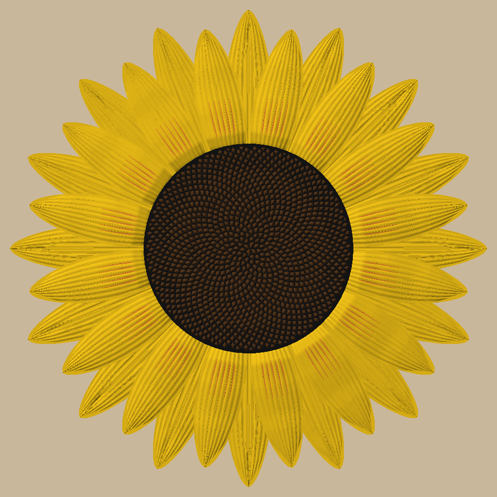

# claude-cad

**Parametric, test-driven CAD for 3D printing, done with [Claude Code](https://claude.com/claude-code).** Parts are
Python ([build123d](https://github.com/gumyr/build123d)). The build exports real CAD (**STEP**) for
Onshape/FreeCAD/Fusion, and build plates for the slicer (**3MF**) that open in Bambu Studio already colored, one
filament per part. Tests prove every part prints flat with no supports, is watertight, puts color seams on layer
boundaries, and fits and assembles with its neighbors. Then Bambu Studio's own CLI checks the plates.

It was built for, and battle-tested on, a 3D-printed HO model railroad that runs around a whole room near the
ceiling. That project is the big example; the tool itself is generic. A smaller one, a wall sunflower
(`examples/sunflower-wall`), shows organic shapes and multi-color prints:



```
.
├── .claude/skills/print-cad/      the Claude Code skill: how to work, design rules, lessons learned
│   ├── SKILL.md                   workflow, project layout, design rules, outputs, viewing
│   └── references/
│       ├── build123d-patterns.md  tested snippets and traps (build123d 0.13)
│       ├── printing.md            supports, layers, AMS colors, Bambu project 3MF, checking with the slicer's CLI
│       └── lessons.md             what went wrong on a room-sized build, and the rule each became
├── cadkit/                        the library every project imports (its own uv project, with tests)
├── examples/
│   ├── fit-coupon/                smallest complete project: start here, copy it to start your own
│   ├── near-ceiling-track/        everything at scale: an HO railroad shelf around a room, ~220 tests
│   └── sunflower-wall/            a 16" wall sunflower kit and a 10" one-piece print, four AMS colors
├── CLAUDE.md                      working notes for Claude Code sessions in this repo
├── LICENSE                        MIT
└── README.md
```

## What you get

- **A skill that teaches Claude the method** (`print-cad`): sketch options first, spec with an amendment log, every
  dimension in one `params.py`, parts built test-first in print orientation, an assembly clash test that models the
  room and the hardware, renders you look at before trusting, the slicer as the last test, and an independent
  review before printing.
- **cadkit**, the parts every project needs and nobody should write twice:

  | Module | What it does |
  |---|---|
  | `cadkit.printer` | `Printer(bed, margin, layer, nozzle)`; `A1` default |
  | `cadkit.shapes` | `rect`, `poly` (always counter-clockwise), `grow`, `bowtie` keys, `dovetail` jigsaw tabs |
  | `cadkit.checks` | `printable_problems`, `open_edges` (watertight), `off_layer_z`, `unsupported` (upper color over air), `downward_faces` (bridges) |
  | `cadkit.clash` | pairwise interference with a bounding-box prefilter |
  | `cadkit.paint` | two-color parts as one solid with face colors in the STEP; split bodies for viewers |
  | `cadkit.plates` | MaxRects bed packing; two-color parts on their own plates (one color change each) |
  | `cadkit.bambu3mf` | Bambu Studio project 3MF with a filament per part, plus readers for checking files |
  | `cadkit.bambu` | drive Bambu Studio's CLI: round-trip a plate, slice it, report filament per layer |
  | `cadkit.export` | painted STEP plates + 3MF + `plates.csv`; hidden-line SVG previews |
  | `cadkit.view` | send shapes to OCP CAD Viewer |

- **Two examples**: a fit-test coupon (tune your printer's clearances, and the template for a new project) and the
  railroad, which uses everything.

## Requirements

| What | Why | Get it |
|---|---|---|
| [uv](https://docs.astral.sh/uv/getting-started/installation/) | Installs Python 3.12 and every dependency per project | `curl -LsSf https://astral.sh/uv/install.sh \| sh` (macOS/Linux) or `brew install uv` |
| A slicer | Printing | Bambu Studio: tested, plates open colored. Other 3MF slicers should load the geometry; set colors by hand |
| CAD that imports STEP (optional) | Measuring and fine detail | Onshape (free plan), FreeCAD, Fusion |
| `rsvg-convert` (optional) | Turning SVG previews into PNGs | `brew install librsvg` / `apt install librsvg2-bin` |
| [Claude Code](https://claude.com/claude-code) | Using the skill | — |

Developed on macOS (Apple Silicon). build123d's OCP wheels exist for macOS, Linux and Windows on Python 3.12, which
is why every project pins 3.12. A newer system Python doesn't matter, because uv fetches 3.12 itself.

## Quick start

```bash
git clone https://github.com/jasondouglascox-coder/claude-cad.git
cd claude-cad/examples/fit-coupon
uv sync                                  # first run downloads Python 3.12 + build123d (~1-2 min)
uv run pytest                            # 7 tests; the slicer test runs only if Bambu Studio is installed
uv run python -m fitcoupon.build         # out/plates/fit_coupon_1.3mf (+ STEP, plates.csv)
```

Open `out/plates/fit_coupon_1.3mf` in Bambu Studio (File → Open Project): gray plate, orange marks, one color
change. Print it, try the peg in each hole, and use the clearance that slides.

## Start your own project

- **With Claude:** open this repo (or any folder, with the skill installed below) in Claude Code and describe the
  thing: *"use print-cad to design a wall bracket for my router, 2 screws, prints flat"*. Expect sketches and 2–3
  options first, then a spec, then parts built test-first with renders, then plates checked through the slicer and
  an independent review before you print.
- **By hand:** copy `examples/fit-coupon` next to it, rename the package, and keep the layout: `params.py`,
  `parts.py` (or `parts/`), `build.py`, `tests/`. Point `[tool.uv.sources] cadkit` at this repo's `cadkit/`.

### Installing the skill for all your projects

Project skills in `.claude/skills/` load automatically inside this repo. To use `print-cad` everywhere:

```bash
mkdir -p ~/.claude/skills
ln -s "$PWD/.claude/skills/print-cad" ~/.claude/skills/print-cad
```

## The approach in one screen

- **Every dimension lives in one `params.py`,** including the printer and which AMS slot holds which color. A
  design change is a one-line edit, and tests derive their expectations from params.
- **Parts print flat with no supports.** They're 2D profiles extruded to a thickness, made in print orientation and
  placed into the assembly by a separate transform. Nothing starts over air: not a bridge over a hole, not an upper
  color past the edge of the lower one.
- **Snap or slot to locate, glue only for strength.** Tabs, bow-tie keys, half-laps and latches, with clearances
  tuned by a printed fit-test coupon.
- **The assembly clash test is the backbone.** It includes the environment (walls, ceiling, doors, even walls you
  don't draw), moving envelopes and the hardware, and it has a variant that must fail.
- **Multi-color without the waiting.** Two-color parts change color once, at a layer boundary, and never share a
  plate with single-color parts. The 3MF has one object with a filament per part; the STEP has one painted solid.
- **The slicer is the last test.** Plates round-trip through Bambu Studio's CLI and get sliced: same filaments, same
  geometry, one color change. Three real bugs got past green unit tests and were caught only this way.
- **Look before you trust.** Preview renders and a 3D viewer, because some mistakes pass every test.

The full story of each rule is in [lessons.md](.claude/skills/print-cad/references/lessons.md).

## Viewing

- **OCP CAD Viewer** shows models without any STEP translation: `uv run python -m ocp_viewer --port 3939`, open
  http://127.0.0.1:3939/viewer **first**, then send (`cadkit.view.show(shape)` or an example's `build show`).
- **Onshape:** Create → Import with the plain `.step` (not zipped). Colors and part names come through.

## Troubleshooting

| Symptom | Fix |
|---|---|
| `uv sync` fails on Python / OCP wheels | Run `uv python install 3.12`, then `uv sync` again. Don't change the 3.12 pin. |
| Bambu Studio: "The 3mf is not from Bambu Lab", everything one color | That file came from an old build or another tool. Rebuild; cadkit plates are Bambu projects. Open with File → Open Project. |
| Bambu Studio shows copies of one part where there should be different ones | An old build with per-file mesh ids. Rebuild. |
| The viewer page is blank, or still shows the old model | Open the page **before** sending; reload it and send again. Split very large models. |
| Onshape rejects the file | Upload the plain `.step`, not a zip. Large rooms take minutes to translate. |
| Tests are slow | Use `-n <cores>` (pytest-xdist) and `-m "not slow"` while iterating; run the full suite before committing. |
| `UnicodeEncodeError` in tests | The process has an ASCII locale. cadkit writes UTF-8 explicitly; set `LANG=en_US.UTF-8` for older code. |

## Safety

Things you print can hold things up, including over people (the railroad hangs on walls and a ceiling). Screw into
studs where you can, use anchors rated well beyond the load where you can't, and check your own fixings. No
warranty (see LICENSE).

## License

[MIT](LICENSE). Use it, change it, print it, share it; keep the copyright notice.
