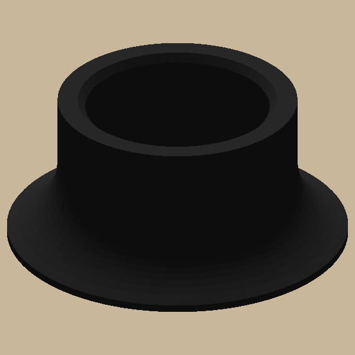
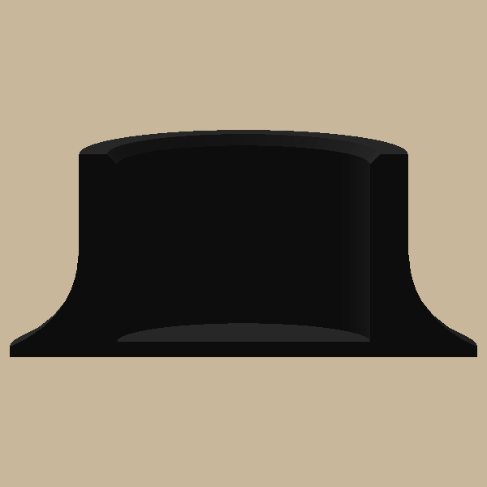

# Candle adapter

 

Hot-glue it into a flat chandelier cup. A thin flared foot (0.8 mm at the edge) rises into a collar where a 20 mm
candle sits 15 mm deep. Black, one piece, no supports.
Sizes in `candle/params.py`; design in `docs/specs/candle-adapter.md`.

```bash
uv sync
uv run pytest                      # printable, sizes, the plate file, and a Bambu Studio slice if installed
uv run python -m candle.build      # out/plates/candle_adapter_1.3mf (opens black), out/step, out/render
```

The pictures in `docs/images/` are copies of `out/render`; refresh them after a visible change.
