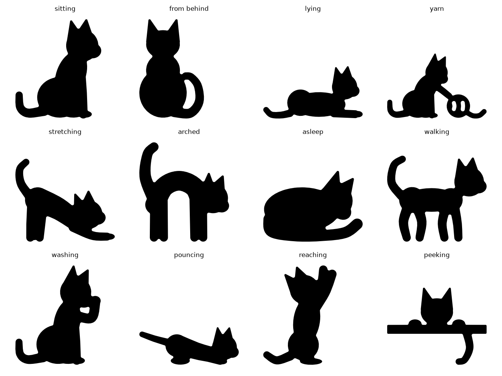
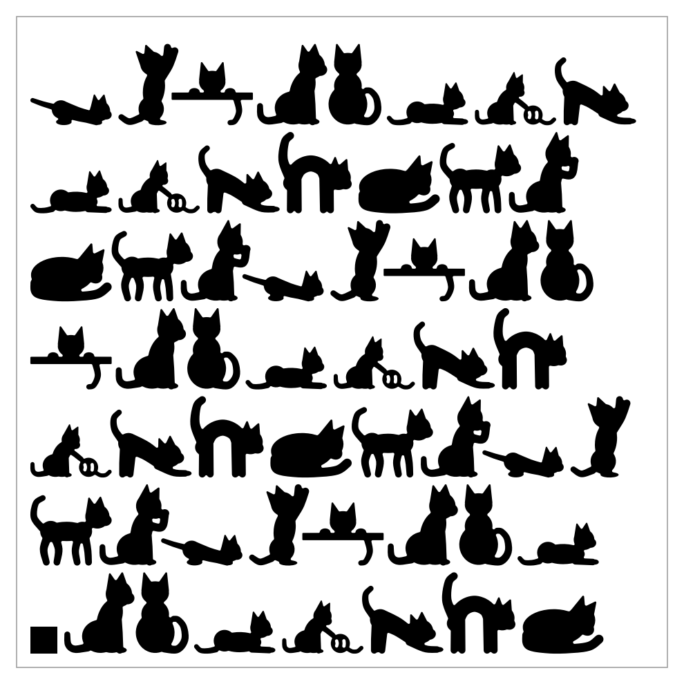

# Cat decals

 

Little black cats cut from vinyl on a Silhouette Cameo. These are not 3D prints: each cat is one solid silhouette,
and the blade cuts only its outline. Twelve poses: sitting, from behind, lying, batting a ball of yarn, stretching,
arched (the Halloween one), asleep, walking, washing a paw, pouncing, reaching up, and peeking over an edge. Each is 3"
on its longer side, and 53 of them fill the 24" × 24" mat with ¼" between them for weeding.

Every pose has to read from its outline alone, so ears, tails and legs do the work, and the tests hold every cut to
what weeds cleanly: no leg, tail or ear narrower than ⅛", and no hole (between legs, in the yarn's winding) narrower
than 0.1".

## Cutting

1. Silhouette Studio (Basic Edition is enough): **File → Open** `out/cat_sheet_in.dxf`.
2. Measure the square at the bottom left. DXF files carry no units, so Studio guesses. If the square isn't 1",
   open `out/cat_sheet_mm.dxf` instead (it's the same sheet in millimetres), or scale the whole sheet until the
   square measures 1".
3. Set the page and mat to 24 × 24, put the vinyl on the mat, and cut with your usual vinyl setting.

To pick your own mix, open single cats from `out/cats/` (one DXF per pose, in inches) and duplicate them in Studio.

```bash
uv sync
uv run pytest -n 4                # weedable cuts, sizes, the sheet on the mat, DXFs read back to scale
uv run python -m cat_decals.build # out/cat_sheet_{in,mm}.dxf, out/cats/*.dxf, out/render/*.png
```

The size and spacing live in `cat_decals/params.py`, and the poses in `cat_decals/cats.py`. Decisions are recorded in
`docs/specs/cat-decals.md`.
