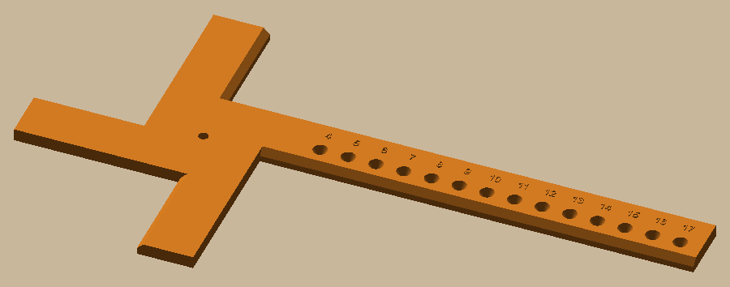
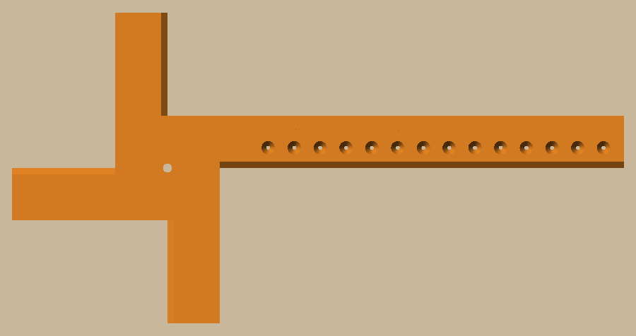

# Circle jig

 

A trammel for marking a circle on a board and splitting it into four exact quarters. It turns on a screw at the
centre; a pencil in one of the holes draws the circle. The bar and the three short arms each have one straight
edge that lies exactly on a line through the screw (bevelled on top like a ruler, so you see the line right at the
edge), a quarter turn apart.

- Pencil holes for circles 4" to 17" across, every inch, numbered by diameter. A sharp pencil (or a 0.5 mm
  mechanical one) drops down the cone onto the hole's centre.
- Pivot: a #8 wood screw (4.5 mm hole), not tightened, so the jig turns on it.
- Orange PLA, AMS slot 1, printed flat across the bed's diagonal with no supports: about 37 g.

**Using it**

1. Screw through the pivot hole into the centre of the board. Pencil in the 17 hole, swing the circle.
2. Draw the first line along the bar's bevelled edge, from the hub out past the circle. That's a radius.
3. Turn the jig a quarter (either way) until the next short arm's bevelled edge sits on that line. The bar is now
   on the next quarter: draw along it.
4. Repeat for the other two quarters. On the last one, the arm should land back on your first line: that's your check.
5. Lift the jig and join the lines across the screw hole with a ruler.

Keep the pencil tight against the edge the same way each time, and line the arm up over its whole 2" length.

```bash
uv sync
uv run pytest -n 6                  # print checks, edges through the pivot, hole radii, the plate, a Bambu slice
uv run python -m circle_jig.build   # out/plates/circle_jig_1.3mf (File → Open Project), out/step, out/render
```

Sizes live in `circle_jig/params.py` (more holes, longer arms). Design and decisions: `docs/specs/circle-jig.md`.
