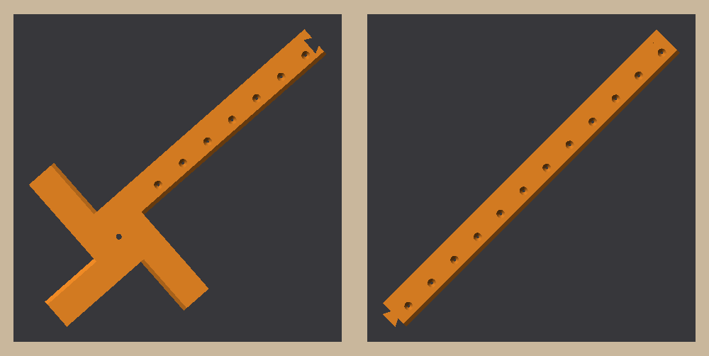
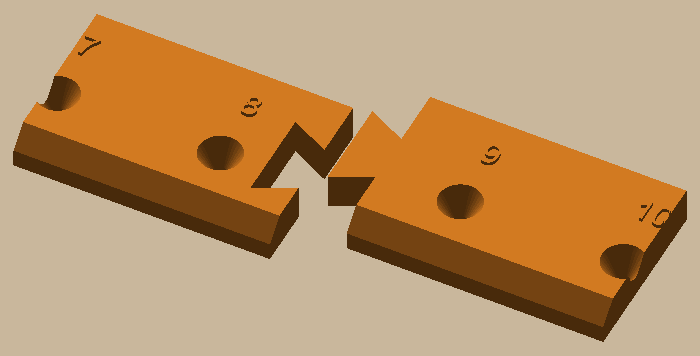

# Circle jig


 

A trammel for marking a circle up to 40" across (20" radius) on a board and splitting it into four exact quarters.
It turns on a screw at the centre; a pencil in one of the holes draws the circle. The bar and the three short arms
each have one straight edge that lies exactly on a line through the screw (bevelled on top like a ruler, so you see
the line right at the edge), a quarter turn apart.

- Pencil holes every inch from 2" to 20", numbered by **inches from the screw** (the radius). A sharp pencil (or a
  0.5 mm mechanical one) drops down the cone onto the hole's centre.
- Pivot: a #8 wood screw (4.5 mm hole), not tightened, so the jig turns on it.
- Two pieces, 518 mm from the screw to the bar's end: the **hub** (arms and the bar to the 8" hole: on its own it
  draws up to 8") and the **extension** (9" to 20"), butted between the 8 and 9 holes. A dovetail tab on the
  extension's end presses down into a socket in the hub, flush. It has no clearance, the fit the railroad's
  keystone test settled on.
- Orange PLA, AMS slot 1, no supports, two plates, each piece across its bed's diagonal: hub 35 g, extension 25 g.

**Putting it together:** lay both pieces upside down on something flat with the bevelled edge against a straightedge,
press the tab into its socket, and run a little CA glue along the seam. The glue stops any kink at the joint, so the
long edge stays a true radius.

**Using it**

1. Screw through the pivot hole into the centre of the board. Pencil in the hole for your radius, swing the circle.
2. Draw the first line along the bar's bevelled edge, from the hub out past the circle. That's a radius.
3. Turn the jig a quarter (either way) until the next short arm's bevelled edge sits on that line. The bar is now
   on the next quarter: draw along it.
4. Repeat for the other two quarters. On the last one, the arm should land back on your first line: that's your check.
5. Lift the jig and join the lines across the screw hole with a ruler.

Keep the pencil tight against the edge the same way each time, and line the arm up over its whole 2" length:
that's about ±2 mm at 20" out, which the last-turn check shows up.

```bash
uv sync
uv run pytest -n 6                  # print checks, edges through the pivot, hole radii, key fit, both plates sliced
uv run python -m circle_jig.build   # out/plates/circle_jig_hub.3mf and circle_jig_extension.3mf, out/step, out/render
```

Sizes live in `circle_jig/params.py` (more holes, longer arms). Design and decisions: `docs/specs/circle-jig.md`.
