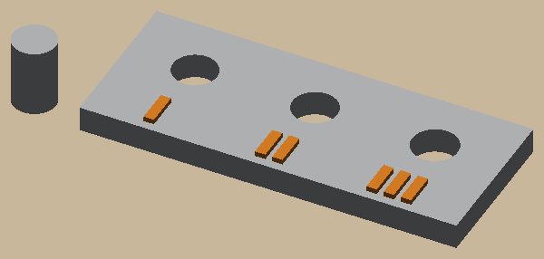

# Fit-test coupon



Print this before anything else. Clearances depend on the printer, the filament and the slicer profile, so a
part's holes and slots come from a measured `fit_slide`, not a guess.

A gray plate with three holes for a 5 mm peg, at 0.1, 0.2 and 0.3 mm diametral clearance. Each hole has 1, 2 or 3
raised orange marks beside it, printed in the second color. The peg prints standing up, so it's round.

```bash
uv sync
uv run pytest                        # printable, watertight, layers, marks on the plate, hole sizes, the plate file
uv run python -m fitcoupon.build     # out/plates/fit_coupon_1.3mf (coupon) and _2.3mf (peg), out/step, out/render
```

Open the plates in your slicer. In Bambu Studio (File → Open Project) the coupon is already gray with orange marks,
filaments 1 and 2 (`FILAMENT` in `fitcoupon/build.py`), with one color change; other slicers load the shapes and
you set the colors. On a one-color printer (`CADKIT_COLORS=1`) it all prints in one color: the marks still stand
up. Push the peg into each hole and use the clearance of the one that slides without wobble.

## As a template

This is the smallest project with the full layout, so copy it to start a new one:

- `fitcoupon/params.py`: every dimension, plus the `cadkit.Printer`;
- `fitcoupon/parts.py`: parts in print orientation; a two-color part is a Compound of labeled, colored bodies;
- `fitcoupon/build.py`: STEP for CAD, packed plates for the slicer (`cadkit.plates.pack`, `cadkit.export.write_plates`),
  and a shaded render (`cadkit.render`) that goes in `docs/images/` and the README;
- `tests/test_coupon.py`: the checks every part needs (`cadkit.checks`), a dimension probe, the plate file, and the
  slicer itself (`cadkit.slicers.active()`, skipped when none is installed).

Start a copy with `uv run --project ../../cadkit python -m cadkit.new my-part`: it lands in your projects folder
(`CADKIT_PROJECTS`, default `examples/`) with the package renamed and cadkit wired up.

The big example, `../near-ceiling-track`, adds layout math, an assembly with a clash test, kits and a room.
