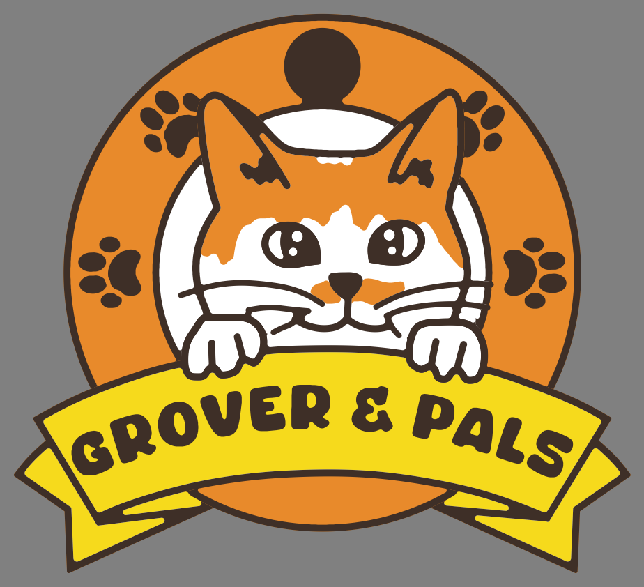
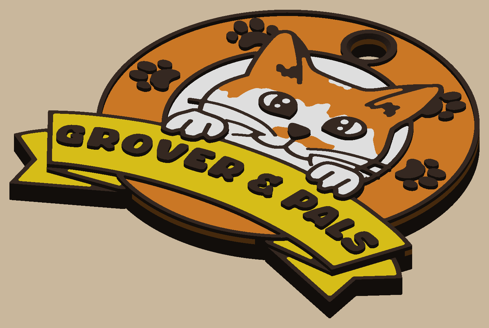

# Grover & Pals keychain

Four-color keychain of the brand logo (`art/logo.svg`), 50 mm wide, with a QR code and the URL on the back.
Design spec: `docs/specs/2026-10-14-keychain-v2.md`. v1 (hand-sketched cat) is kept in `archive/v1/`.

 



```bash
uv sync
uv run python -m grover.build            # out/step, out/plates/grover_keychain.3mf, out/preview
uv run pytest -q -n 4 -m "not slow"      # ~40 min (each worker builds the bodies); slow: the plate through Bambu Studio
```

## How it is built
The logo's raster is classified into its palette; the dark line work is split into thick marks (kept as drawn)
and thin strokes (re-drawn 0.5 mm wide); the ears' outlines are drawn as smooth curves through points in
`params.py`; fills are cleaned to nozzle-printable widths; everything is vectorized
and stacked into print bands (see the spec's table). Every dimension is in `grover/params.py`.

## Printing (Bambu A1 + AMS lite, 0.2 mm layers, 0.4 nozzle)
1. File → Open Project: `out/plates/grover_keychain.3mf`. It opens with a filament per body: orange 1, yellow 2,
   white 3, brown 4 (change the slots in `params.py` if yours differ).
2. The back (QR + URL) is on the plate; textured PEI gives a matte finish that scans well.
3. No supports. "Flush into object's infill" hides most purge in the brown body.
4. Expect 22 filament changes: 3 on the back inlay, 2 under the sunk tails (layers 8-9), 9 in the base band (the
   sunk folds and tails bring yellow and brown into it), 6 in the face band, 2 on top. Bambu Studio's estimate:
   15.8 g, about 65 min of printing plus the changes. The plate's profiles are all
   `filament_type` (PLA) from `params.py`; pick your own presets in the slicer if they differ.
