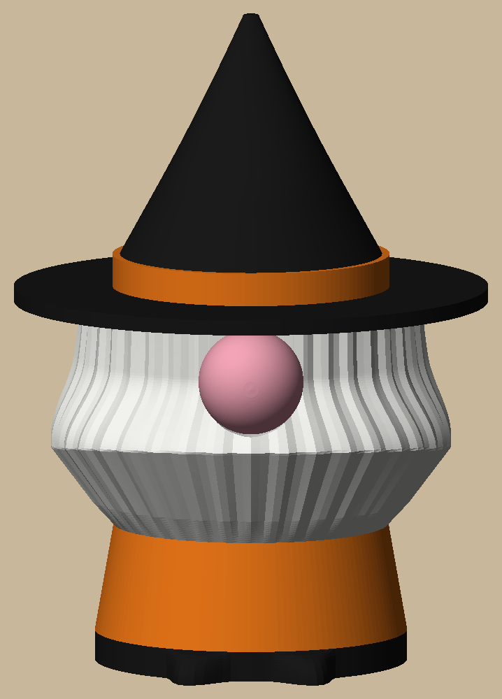
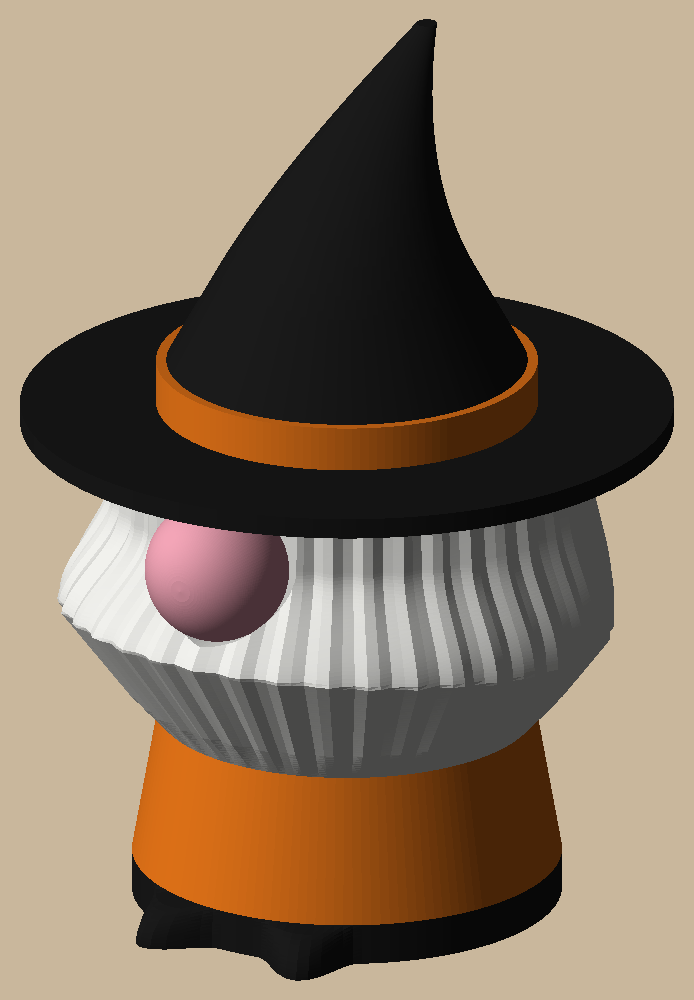
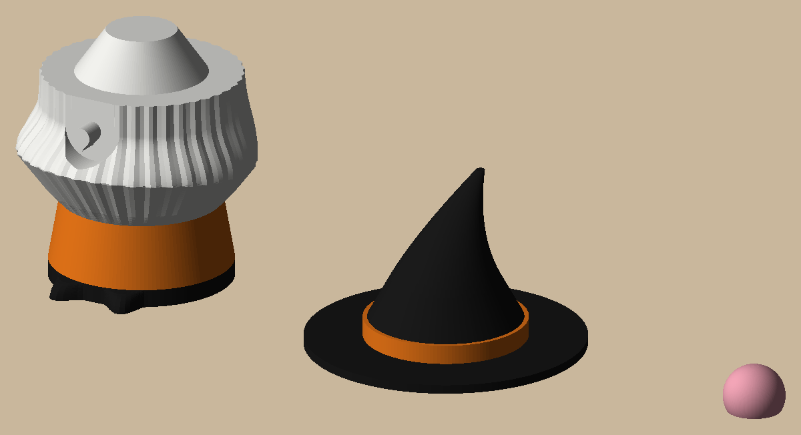

# Halloween gnome

  

A 2" witch-hat gnome for the top of a mini Christmas tree: the tree's tip goes up a 1/2" hole in his base. He
prints in three pieces with no supports, then presses together, no glue:

- **Body:** black boots, orange robe, white beard and hair (2 colour changes). The hole runs 18 mm up the middle.
- **Hat:** printed brim down: black brim, orange band, black crooked crown (2 colour changes). Its cone socket
  pushes down over the head.
- **Nose:** pink, presses onto the teardrop peg on the face (point down). There's no clearance on either fit, so
  it's a squeeze.

AMS: 1 orange, 2 white, 3 black, 4 pink, all PLA. About 16 g of filament in total.

```bash
uv sync
uv run pytest -n 6                        # print checks, fits, the plates, and a Bambu slice of each
uv run python -m halloween_gnome.build    # out/plates/halloween_gnome.3mf (a plate per print), out/render
```

Open `out/plates/halloween_gnome.3mf` with File → Open Project; each print is also on its own as
`gnome_body`, `gnome_hat`, `gnome_nose`. Decisions are in `docs/specs/halloween-gnome.md`.
