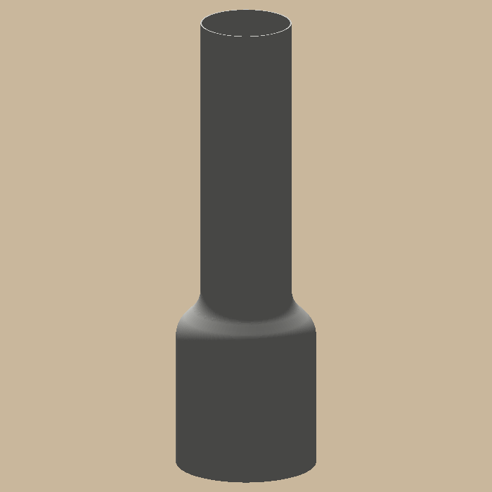
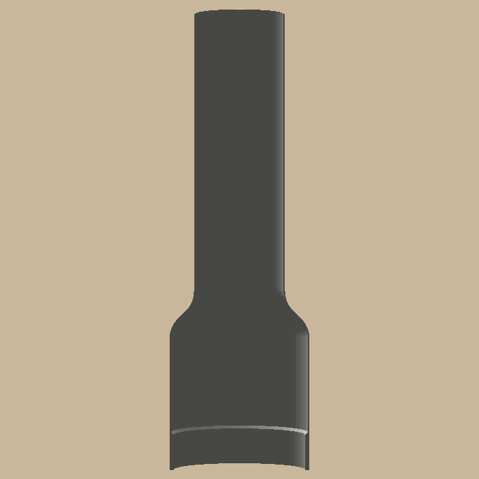

# Lamp chimney

 

A white printed replacement for the broken glass chimney of an LED oil-lamp-style lamp. The Ø40 foot drops into the
scalloped gallery, where the spring tabs grip it; above it the wall is a single 0.42 mm line, so it glows evenly
from the LED candle inside. A 45-degree shoulder with rounded bends steps down to the Ø26 neck; 131 mm tall.

- White PLA, AMS slot 1, printed upright with no supports: about 7.6 g and 1 h 15 min on the A1.
- The project carries its slicer settings: Arachne walls (one bead in the thin wall, three in the foot) and an 8 mm
  brim outside and inside the foot. Peel both brims off before fitting.
- If the one-line wall fails, set `wall = 0.84` (two lines) in `lamp_chimney/params.py` and rebuild.

```bash
uv sync
uv run pytest -n 4                    # print checks, sizes, the plate, and a Bambu slice (one bead, both brims)
uv run python -m lamp_chimney.build   # out/plates/lamp_chimney_1.3mf (File → Open Project), out/step, out/render
```

Design and decisions: `docs/specs/lamp-chimney.md`. Measurements: `docs/measurements.md`.
