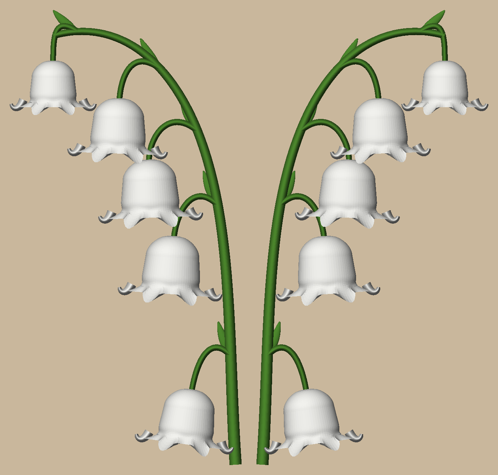

# Lily of the valley wall flower

An arching sprig of lily of the valley, 188 mm tall, to hang with the sunflower (`../sunflower-wall`), the rose
(`../rose-wall`) and the peony (`../peony-wall`). Green PLA for the stem, pedicels and bracts, white for the five
bells, white down to the wall, printed in one go flat-back on a Bambu A1 with **no supports**.

  

It prints two to a plate, the second a mirror image, so they can hang as a pair:



Each bell has a rounded shoulder, a slight waist and a flared rim of six scalloped lobes: the two at the sides curl
back, the two facing you reach past the rim. A small pointed bract sits where each pedicel leaves the stem.

## How it prints without supports, in two colours

The stem, pedicels, bracts and the bells' curled side lobes are half-ovals standing on the bed: their round comes
down to the wall, so nothing overhangs. The bells are tubes whose sections are round on top and, underneath, run in
to the bed at 46 degrees or steeper, hidden under the round. Colour goes by part: the bells are white all the way to
the wall, the rest green. The green is 4 mm tall, so the first 20 layers print both colours: 20 colour changes.

## Printing it

`uv run python -m lily_of_the_valley.build` writes `out/plates/lily_of_the_valley.3mf`: a Bambu project with the
sprig and its mirror image (two objects), green PLA in AMS slot 1 and white in slot 2, supports off. Sliced: 2 h 22 m,
44.0 g (10.4 g green, 33.6 g white), 20 colour changes (one a layer up to 4 mm, both sprigs at once). One sprig
alone (`pair=False` in `params.py`): 1 h 31 m, 24.4 g.

Hang it on a nail or pan-head screw through the keyhole in the back (under the third bell): it goes 68.3 mm below
the sprig's top and 38 mm in from its left edge (the mirror image: from its right edge). Use a 6-8 mm head on a shank under 4.5 mm, its head standing about
2 mm off the wall: the lip that goes behind it is 1.6 mm thick, with 3.2 mm of room over it. A smaller head pulls
out of the 4.6 mm slot. It hangs from its printed centre of mass (the thin green parts print solid, the bells mostly
infill), within half a degree of upright.

## Commands

```bash
uv sync
uv run pytest -n 6 -m "not slow"                # ~12 s: shapes, bells, one piece, colours, keyhole, plate
uv run pytest -m slow                           # ~10 s: the plate through Bambu Studio
uv run python -m lily_of_the_valley.build       # out/plates, out/render
```

Design and decisions: `docs/specs/2026-10-26-lily-of-the-valley-design.md`. The pictures in `docs/images/` are
`out/render/` copies; refresh them after a visible change.
