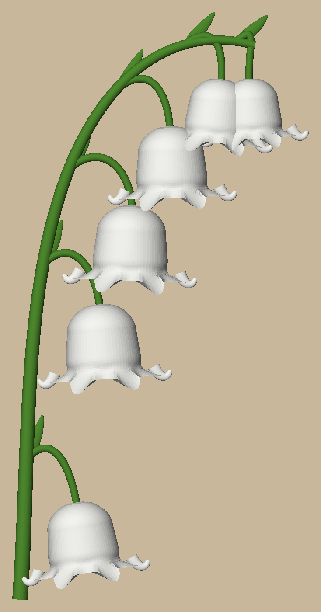
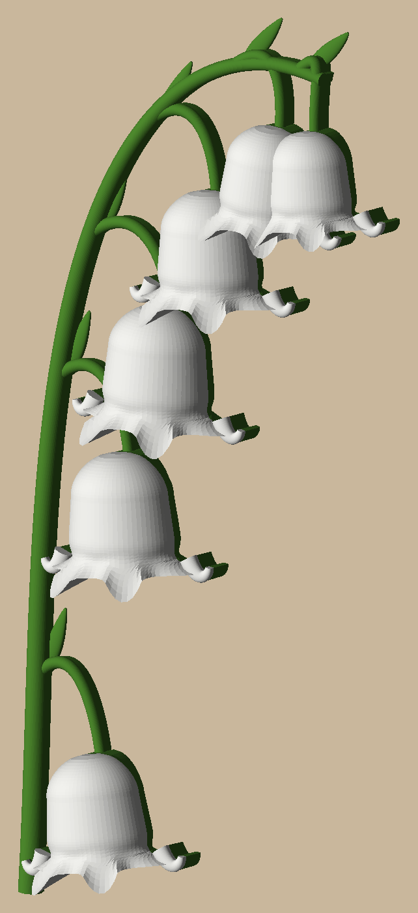
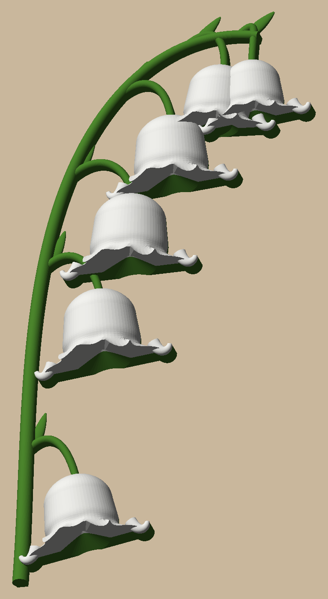

# Lily of the valley wall flower

An arching sprig of lily of the valley, 188 mm tall, to hang with the sunflower (`../sunflower-wall`), the rose
(`../rose-wall`) and the peony (`../peony-wall`). Green PLA for the stem, pedicels and bracts, white for the six
bells, printed in one go flat-back on a Bambu A1 with **one colour change and no supports**.

  

Each bell has a rounded shoulder, a slight waist and a flared rim of six scalloped lobes: the two at the sides curl
back, the two facing you reach past the rim. A small pointed bract sits where each pedicel leaves the stem.

## How it prints without supports, in two colours

Every part is a tube whose sections are round on top and, underneath, run in to the bed at 46 degrees or steeper.
From the front you only see the round tops; the fills hide under them. Colour goes by height: green up to 5 mm
(the stem's top), white above it, where the bells sit, so one swap gives white bells on a green sprig.

## Printing it

`uv run python -m lily_of_the_valley.build` writes `out/plates/lily_of_the_valley.3mf`: a Bambu project with green
PLA in AMS slot 1 and white in slot 2, supports off. Sliced: 1 h 11 m, 23.2 g (12.4 g green, 10.8 g white), one
colour change.

Hang it on a nail or pan-head screw through the keyhole in the back (under the third bell): it goes 68.5 mm below
the sprig's top and 39 mm in from its left edge. Use a 6-8 mm head on a shank under 4.5 mm, its head standing about
2 mm off the wall: the lip that goes behind it is 1.6 mm thick, with 3.2 mm of room over it. A smaller head pulls
out of the 4.6 mm slot. It hangs from its printed centre of mass (the thin green parts print solid, the bells mostly
infill), within half a degree of upright.

## Commands

```bash
uv sync
uv run pytest -n 6 -m "not slow"                # ~10 s: shapes, bells, one piece, colours, keyhole, plate
uv run pytest -m slow                           # ~10 s: the plate through Bambu Studio
uv run python -m lily_of_the_valley.build       # out/plates, out/render
```

Design and decisions: `docs/specs/2026-10-26-lily-of-the-valley-design.md`. The pictures in `docs/images/` are
`out/render/` copies; refresh them after a visible change.
