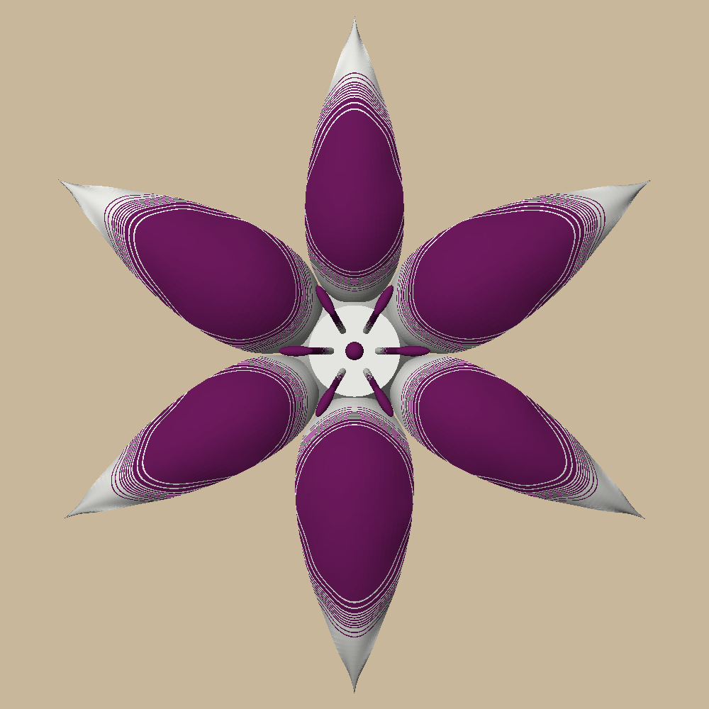
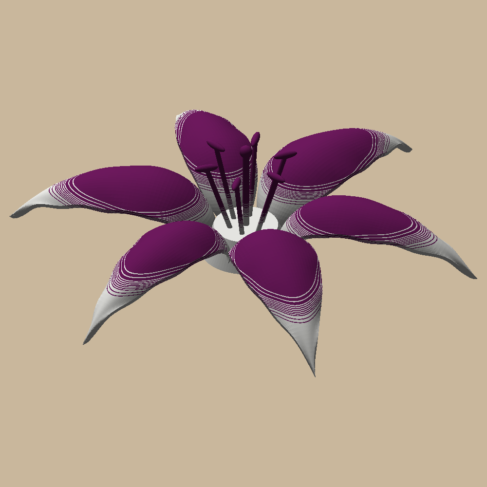
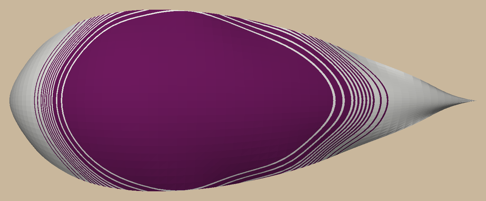

# Lily wall decor

An open lily, about 180 mm across (70% of the bed), to hang with the sunflower, the rose and the peony
(`../sunflower-wall`, `../rose-wall`, `../peony-wall`). White and purple PLA, printed in one go flat-back on a Bambu
A1 + AMS lite, the purple fading into white.

 

## The fade

Printed face-up, each tepal rises straight out of the throat, arches over and recurves down until its tip lands on
the bed, its edges curling down from the midrib. So its heart is the highest part and its tips, margins and the
throat are low: white below a height, purple above it, the seam following each tepal's shape like the photo's
blotch. Round the seam, in an 8 mm band, whole layers alternate white and purple, the purple share rising from 0 to
1: one AMS swap per switch, 21 in all. Up close it's fine stripes following the curve; from a step back, a fade.



## Printing it

`uv run python -m lily_wall.build` writes `out/plates/lily.3mf`, a Bambu project that opens with everything set:
white PLA in AMS slot 1, purple in slot 2. The arches need tree supports, printed in whatever's loaded with a layer's
gap so they snap off; their marks are on the tepals' undersides, against the wall. (A gray PETG interface would peel
cleaner but swapped 110 times: 9.8 h against 4.3.) Sliced: 4.3 h, 50 g (28 g white, 21 g purple), 21 colour changes.

Hang it on a nail through the keyhole under the throat: the nail goes where you want the centre.

## Commands

```bash
uv sync
uv run pytest -n 6 -m "not slow"     # ~10 s: tepals, the fade's layers, colours split exactly, keyhole, plate
uv run pytest -n 6                   # + Bambu Studio slicing it: one colour a layer, just the fade's 21 changes
uv run python -m lily_wall.build     # out/plates, out/render
```

Design and decisions: `docs/specs/2026-10-22-lily-design.md`. The pictures in `docs/images/` are `out/render/`
copies; refresh them after a visible change.
