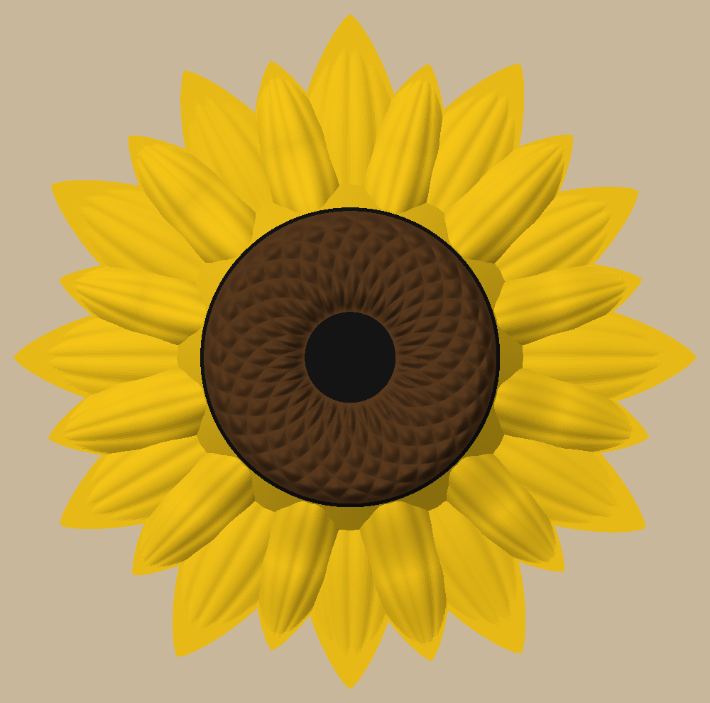
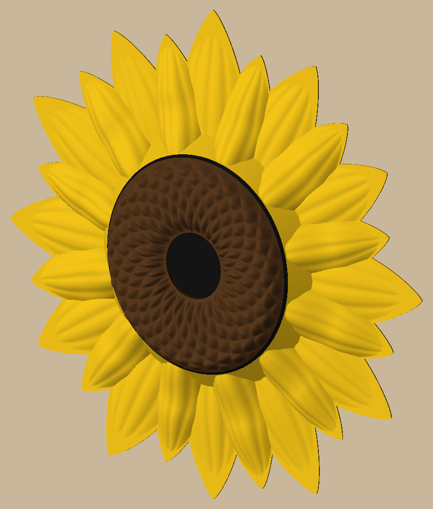
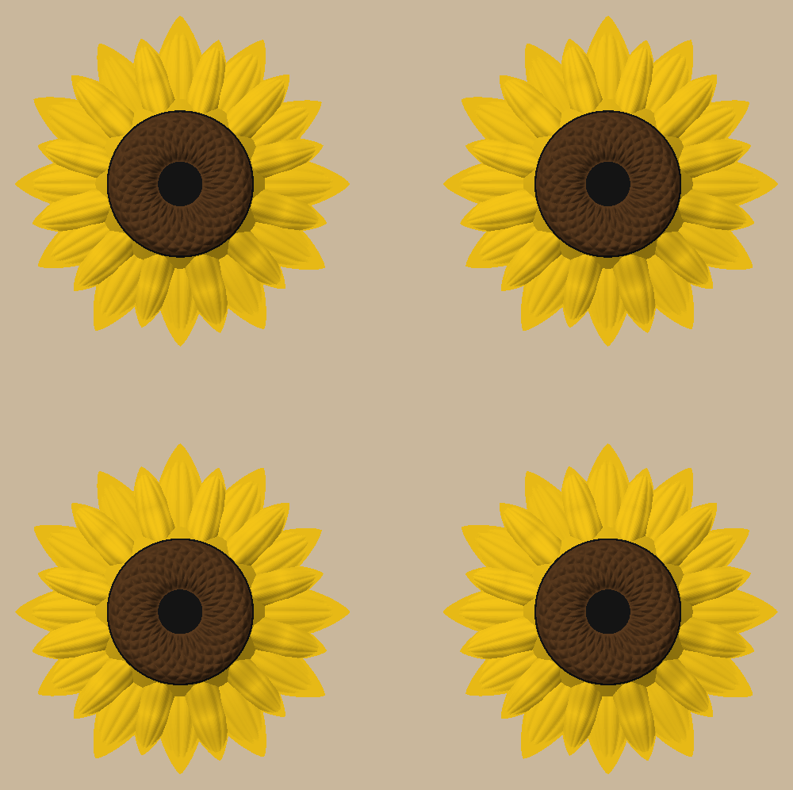

# Mini sunflower

  

A 3" (76 mm) wall sunflower, smaller than the 4" roses: 24 pointed yellow petals in two rings, a brown ring doming
about 3 mm up from them, textured with diamonds where the sunflower's two seed spirals cross, round a black eye sunk in the
middle. Every petal angles down to the wall, and the head's side angles up from the petals through the black to the
brown at 45 degrees, with no straight-up edges. It prints in one go, back on the bed, with no supports, and hangs on a nail through a keyhole under the head.

Colours by height, 2 swaps a plate: yellow up to 4 mm, a two-layer black disk, then the brown. AMS as loaded for the
big sunflower: 1 orange (unused), 2 yellow, 3 black, 4 brown, all PLA. Four to a plate round the prime tower:
about 1 h 40 min and 28 g (21.5 yellow, 1.6 black, 5.1 brown).

```bash
uv sync
uv run pytest -n 6                      # print checks, the head, the keyhole, the plate, a Bambu slice
uv run python -m mini_sunflower.build   # out/plates/mini_sunflowers.3mf (File → Open Project), out/render
```

Decisions are in `docs/specs/mini-sunflower.md`; the reference photo is in `docs/references/` (local only).
