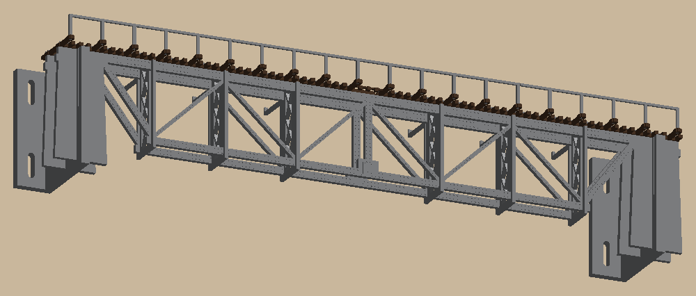
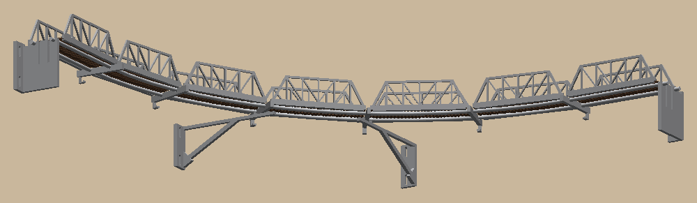
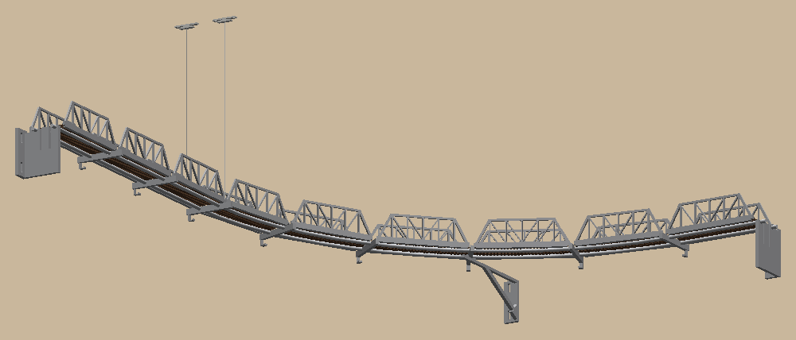
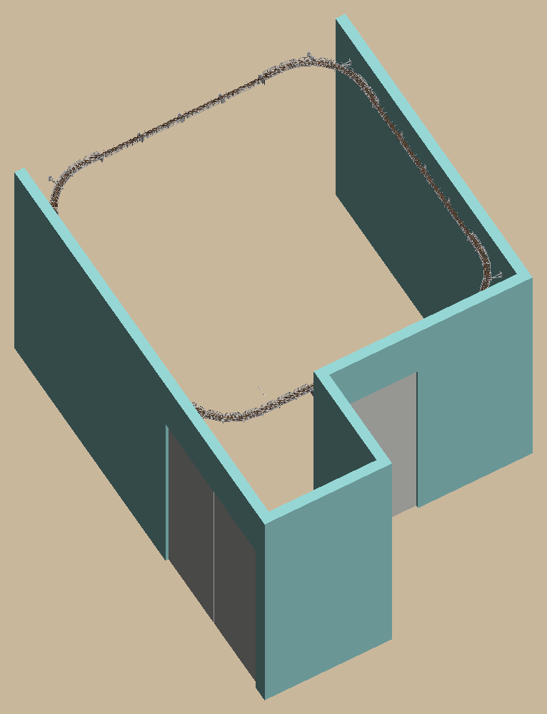
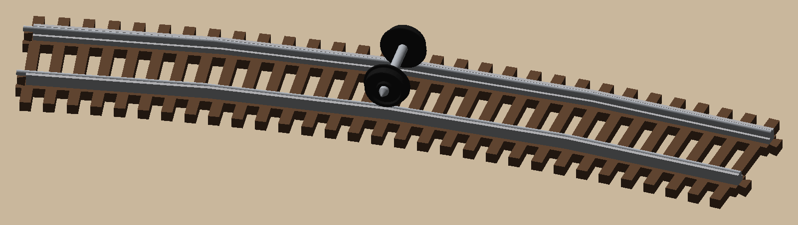
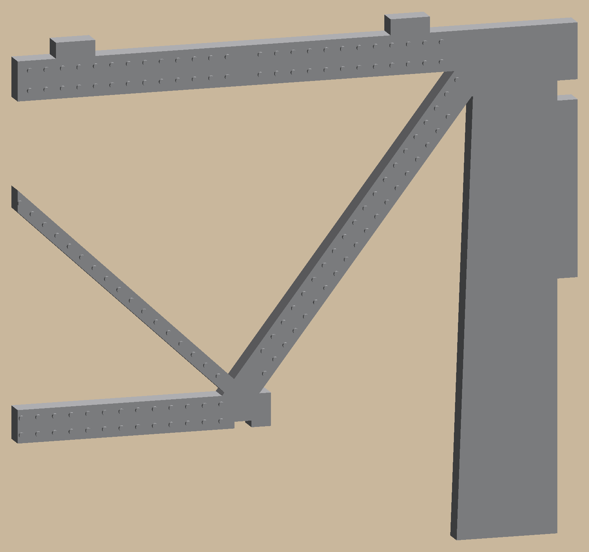

# Near-ceiling HO track (claude-cad example)

A parametric, 3D-printable bridge shelf that carries HO Code 100 track around a room near the ceiling. Straight
runs are deck trusses (or open-spandrel arches) on wall brackets. Corners are pony-truss spans on bent aluminum rods.
Everything prints flat, with no supports, at most one color change per plate, and snaps together. It's the big
example for claude-cad: the generic tooling it uses (print checks, plate packing, two-color parts, Bambu plates,
slicer checks) lives in [`cadkit`](../../cadkit), and the lessons it taught are in the
[print-cad skill](../../.claude/skills/print-cad/references/lessons.md).

 

 



One straight bay from above and from the floor; the inside and bridge corners; and the whole room (front wall left
out). The pictures are `uv run python -m hotrain.build render --run-style deck_truss` output (~11 min, most of it
the room); refresh them after a visible change.

- **What and why:** [docs/overview.md](docs/overview.md)
- **Decisions:** [docs/specs/](docs/specs/), each with an Amendments log
- **Wall measurements:** [docs/measurements.md](docs/measurements.md)

All commands below run from this directory (`examples/near-ceiling-track`).

## Setup

You need [uv](https://docs.astral.sh/uv/). It installs Python 3.12 and every dependency:

```bash
uv sync
```

## Build

| Command | Output |
|---|---|
| `uv run python -m hotrain.build starter --run-style deck_truss` | `out/starter/`: **one 16" bay ready to print** (3 plates + the fit-test coupon) and `plates.csv` |
| `uv run python -m hotrain.build plates --run-style deck_truss` | `out/plates/*.3mf` + `.step`: every build plate for the runs and corners; `out/plates.csv` says how many of each |
| `uv run python -m hotrain.build all --run-style deck_truss` | Every part (`out/step/*.step`), the run assembly, the fit test and `out/manifest.csv` |
| `uv run python -m hotrain.build corners` | `out/corners/*.step`, both corner assemblies, and `out/corners_layout.csv` (where to mark anchors, brackets and ceiling cleats; rod cut lengths) |
| `uv run python -m hotrain.build room --run-style deck_truss` | `out/step/office.step`: the whole room, colored (~200 MB) |
| `uv run python -m hotrain.build render --run-style deck_truss` | `out/render/*.png`: shaded pictures of a bay, both corners and the room |
| `uv run python -m hotrain.build check` | Interference check; exits 1 on any clash |

Options:
- `--run-style deck_truss|arch`: straight-run look. The code default is `arch`.
- `--corner-style pony|bowstring`: corner side frames.
- `--mesh` adds STL files; `--preview` adds SVG line drawings.
- `--out DIR` changes the output folder (default `out`).

## Look at it

**Fast (no translation):** the OCP CAD Viewer.

```bash
uv run python -m ocp_viewer --port 3939
```

Open http://127.0.0.1:3939/viewer **first**, then send a model:

```bash
uv run python -m hotrain.build show room --run-style deck_truss
```

Targets: `room`, `run`, `inside`, `bridge`, `fit-test`. If the page stays blank, reload it and send again.

**Detail and measuring:** Onshape. Use Create → Import with the **plain** `.step`; Onshape rejects zipped STEP.
A whole-room file takes a few minutes to translate.

## Print

- Bambu A1 (256 × 256 mm bed), PETG, 0.4 mm nozzle, 0.2 mm layers, **no supports**.
- **Print `fit_test` first.** Pick the variant of each joint (1/2/3 notches) that fits, then retune `fit_slide`,
  `fit_snap` and `rail_base_w` in `hotrain/params.py` and rebuild.
  - The three rivet strips (1/2/3 notches = 0.6/0.8/1.0 mm heads) show how the deck truss rivets come out. If
    you like another size better, set `rivet_d`; if PETG strings between the heads, fix that before printing
    panels.
- Every plate 3MF is a **Bambu Studio project** that opens already colored (File → Open Project, or "Open as
  project" when asked). Filament 1 is gray PETG, 2 brown PETG and 3 white PLA, matching the AMS. Change
  `filament_gray`, `filament_brown` and `filament_white` in `hotrain/params.py` if the slots move.
- Tie-ladder and corner-deck plates are two-color: each part is one object, brown "wood" and gray "steel" parts.
  One color change per plate, at the tie tops.
- Every other plate is single-color gray, except `bridge_corner_cleats`: the two ceiling cleats, alone in white
  PLA (PLA prints cooler than PETG, so it never shares a bed with gray).
- Each kit also comes as **one project with every plate** (a tab per plate): `out/plates/near_ceiling_track.3mf`,
  `out/starter/starter.3mf`, `out/wire_test/wire_test.3mf`. Plates printed more than once say "(print n)".
- Brown/gray plates leave the back-left corner free for Bambu's prime tower.

## Share it on MakerWorld

```bash
uv run python -m hotrain.build makerworld   # out/makerworld: one sliced project per print profile
```

One model, five print profiles:
- `starter_deck_truss` and `starter_arch`: a 16" bay plus the fit test;
- `corners_pony` and `corners_bowstring`;
- `wire_rail_test`, at 0.08 mm layers.

Every plate is sliced, with its G-code and a thumbnail. Open each in Bambu Studio to check it, then upload. The
checklist is in the print-cad skill (`references/printing.md`, "Sharing on MakerWorld").

## Try stainless wire rail (experiment)



A cheaper rail: 16 AWG (1.29 mm) 304 stainless wire laid into a printed gray web, in place of commercial Code 100
rail. The decision record is in [`docs/specs/2026-10-16-wire-rail-design.md`](docs/specs/2026-10-16-wire-rail-design.md).

```bash
uv run python -m hotrain.build wire-test   # out/wire_test: plates, plates.csv, a render, a STEP with wires + wheelset
```

- `wire_curve_single`: one 18° piece of the corner radius. Seat and glue a wire in it first.
- `wire_curve_corner`: five pieces that chain (jigsaw tabs) into the full 90° corner, for running a train.
- These plates open at **0.08 mm layers** (0.16 mm first layer). The web can't form at 0.2 mm. Brown/gray still
  swap once, at the tie tops.
- Measure the wire with calipers and set `wire_d` in `hotrain/params.py` before printing.

## Rivets



The deck truss has gray rivet heads on its room face: 0.8 mm dots, two layers proud, in rows along every member.
The pier stays bare. Each panel prints one normal half and one mirror-image half (`…_start`), so both halves show
their rivets to the room. Set `rivet_d = 0` in `hotrain/params.py` for flat panels. The corner trusses have none
yet: their room face prints against the bed.

## Install a straight bay

1. **Brackets** at each pier: #8 screws into studs, or self-drilling drywall anchors where there's no stud. Level
   them with the ±¼" slots, then tighten.
2. **On the bench:**
   - Join each side's two truss halves with the bow-tie keys: one `arch_half_…` and one `arch_half_…_start` (its
     mirror image), **rivet side out toward the room**. Both panels of a bay are built the same way.
   - Slide the cross-frames up onto both panels at the posts. They only go in from below.
   - Glue the cross-frames (and optionally the keys), making one rigid box.
3. **Hang the box:** drop it into the brackets. The half-lap notches seat and the latches click.
4. **Tie ladders** on top: tabs into the top chord, jigsaw joints between pieces. A single free-standing bay can
   have its ladders and handrail fitted on the bench before hanging.
5. **Handrail:** pegs into the long-tie sockets, a drop of glue each.
6. **Rail:** press it into the tie plates (the outer lips catch the rail base).
7. **Feeders:** solder at the mid-bay gaps, to the **outside** of the rail.
   - Wall rail: the feeder drops behind the wall-side panel.
   - Room rail: thread the feeder through the groove under both rails (the gap's first opening), solder it along
     the rest of the gap, and drop it on the wall side with the wall rail's feeder.

Corner spans: bend and fit the two rods, set the anchors, deep brackets and floor beams, lay each deck on the rods,
then glue its trusses on. Hang the bridge corner from the ceiling cleat with braided line. Details are in
[docs/overview.md](docs/overview.md).

## Change it for your room

- **Every dimension:** `hotrain/params.py`.
- **Your wall:** set `BAYS` in `hotrain/layout.py` to your bracket-to-bracket distances in mm. Each must be
  8"–18.9" (203–480 mm); add a bracket on drywall anchors to split longer stud gaps. Set `RUN_ENDS` to `CORNER` for
  ends that meet a corner.
- **The room:** `hotrain/room.py` (`Room`) holds the wall lengths and door positions.
- Then run the tests and rebuild.

## Tests

```bash
uv run pytest -n 6 -m "not slow"   # everyday check, ~2 min
uv run pytest -n 6                 # full suite, ~14 min on 6 cores
```

`slow` marks the whole-room, whole-corner, all-plates and file-writing checks. Set `-n` to your number of
performance cores.
