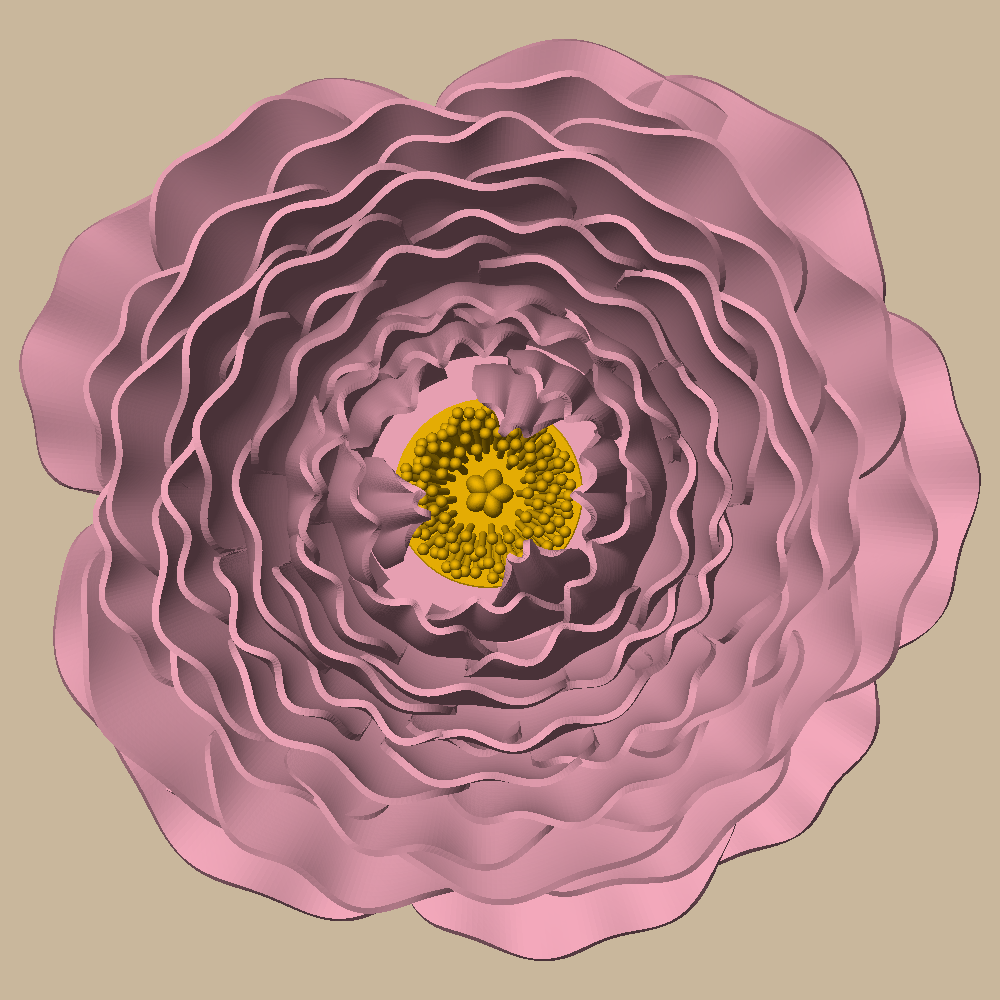
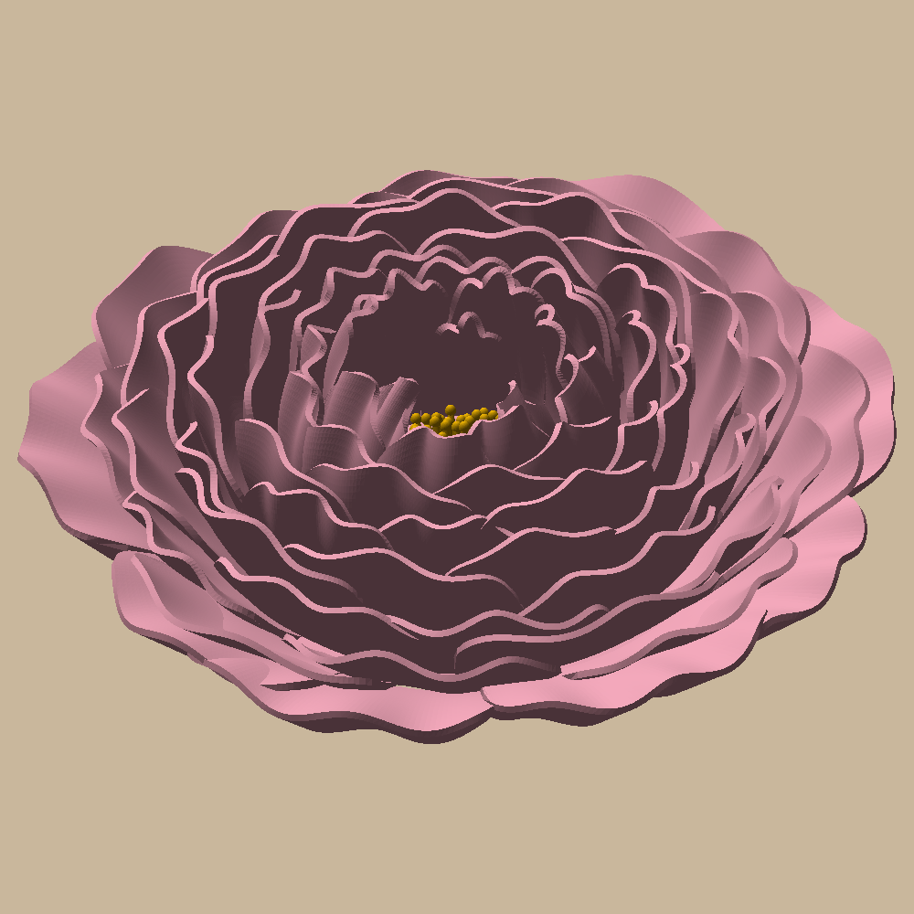
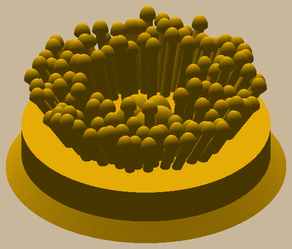

# Peony wall decor

A tight peony, about 8" (203 mm) across, to hang with the sunflower (`../sunflower-wall`) and the rose
(`../rose-wall`). Soft pink PLA, printed in one go flat-back on a Bambu A1 with **no supports**, plus a small yellow
stamen insert that pushes in from the back.

 

81 ruffled petals: 9 low guard petals round the outside, 70 on a golden-angle spiral from leaning out at the edge to
upright and curling in at the middle, and 3 folding across the opening, so ruffled rims run right in to the yellow
and only some of it shows.



## How it prints without supports

Each petal rests on the one below it: under every petal a hidden fill runs down at 45 degrees to whatever is under
it (another petal, or the bed). From the front you only ever see petals' top faces, so the fills never show; the
tests check both (no face past 45 degrees on any of the 81 petals; the front view is the same with and without the
fills). Petals that never lean past 45 degrees are just their wall.

The petals are freeform, too much for B-rep booleans (OCC fused them into invalid pieces), so each one is a mesh
built straight from its point grid and the flower is one exact mesh union (`cadkit.mesh`, manifold3d). So there's
no STEP: each plate comes with an STL.

## Printing it

`uv run python -m peony_wall.build` writes two Bambu projects in `out/plates/`:

- `peony.3mf`: soft pink PLA, AMS slot 1, supports off. Sliced: 10.9 h, 353 g (the fills make it fuller than the
  rose; lightning infill saves only 15 g).
- `stamens.3mf`: yellow PLA, slot 2. Sliced: 0.8 h, 9 g.

Push the insert into the centre hole from the back until its flared foot stops it; on the wall, the wall holds it
in. Hang it on a nail through the keyhole in the back: the nail goes 70 mm above where you want the centre.

## Commands

```bash
uv sync
uv run pytest -n 4 -m "not slow"     # ~40 s: petals, fills hidden, one piece, insert path, keyhole, plates
uv run pytest -n 6 -m slow           # ~3 min: every petal's overhangs, both plates through Bambu Studio
uv run python -m peony_wall.build    # out/plates, out/render
```

Design and decisions: `docs/specs/2026-10-22-peony-design.md`. The pictures in `docs/images/` are `out/render/`
copies; refresh them after a visible change.
