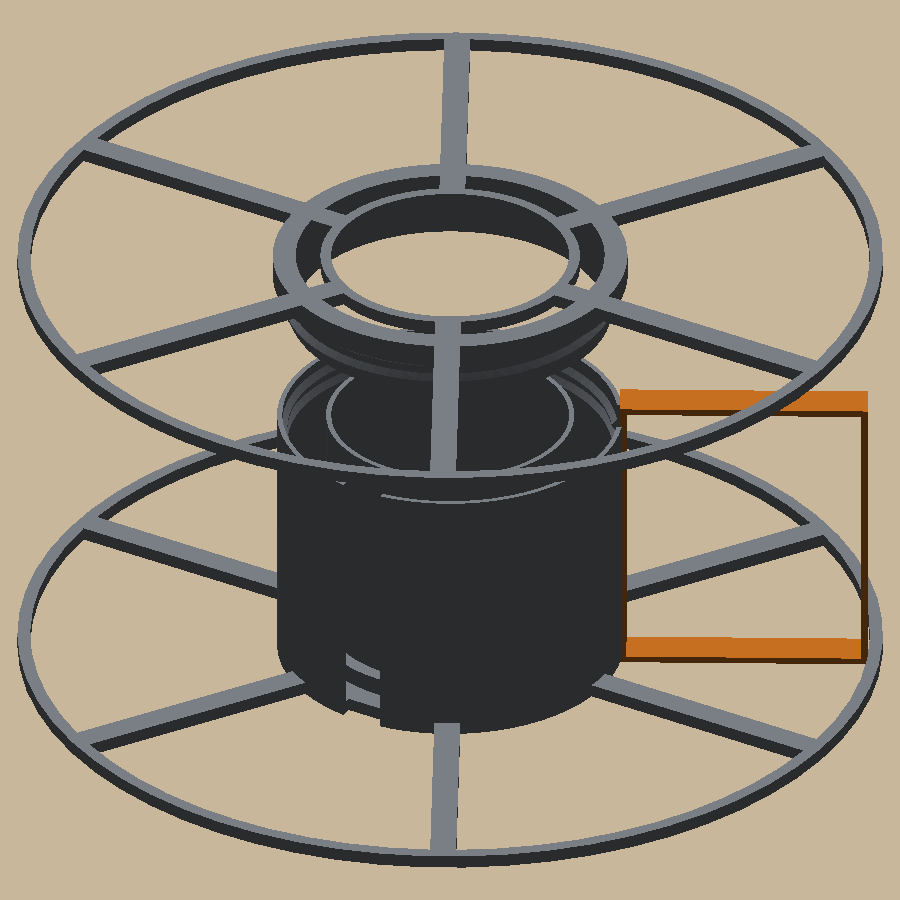
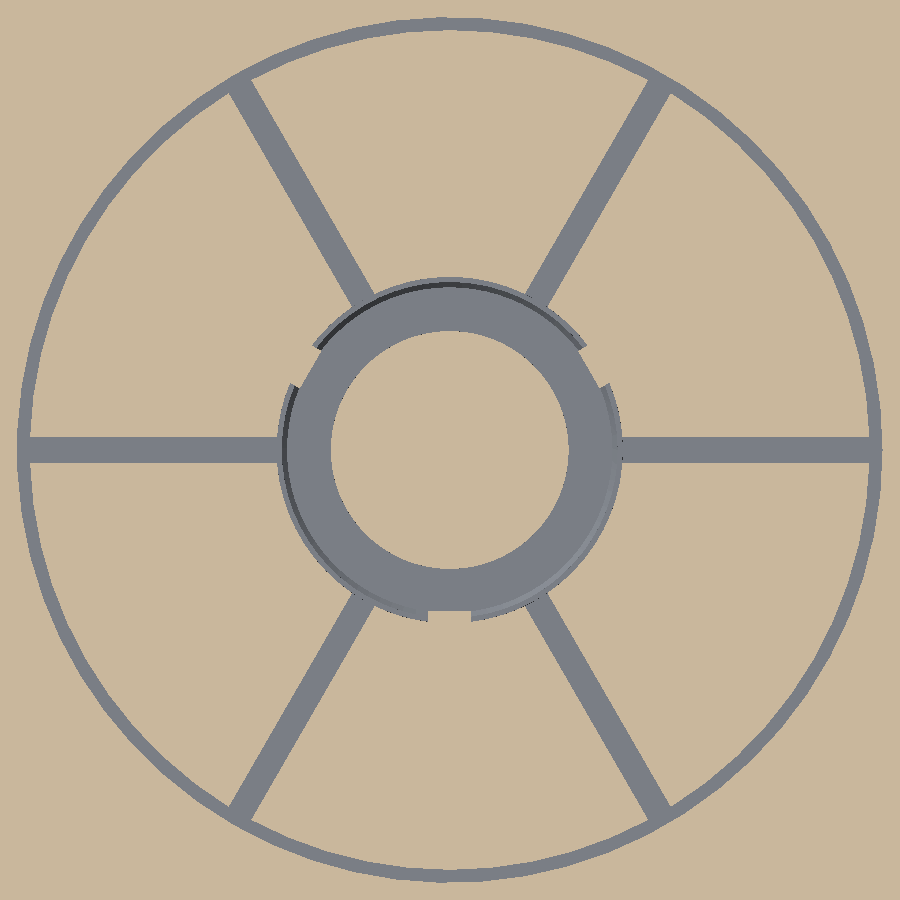

# Refill spool

 

A reusable spool for Bambu Lab 1 kg refill coils, made to use as little filament as possible: about 78 g of PLA
for both halves, against ~220 g for a solid printed spool. Spoked flanges with a thin rim, a slotted Ø80 barrel,
and a cap that screws into the barrel top. It fits the AMS lite (Ø55 bore with the drive notch, 65 mm wide).
Zip ties thread through the barrel slots and round the coil, so the coil comes off in one piece.

```bash
uv sync
uv run pytest -n 2                     # print checks, sizes, thread fit, strap paths, plates, the slicer (if installed)
uv run python -m refill_spool.build    # out/plates/refill_spool.3mf (both plates), out/step, out/render
```

Print both halves outer face down, no supports (PLA, AMS slot 3; don't dry filament on it above ~50 °C). The barrel half has the AMS lite drive notch: mount it with
that side toward the drive.

- **Load a refill:** slide it onto the barrel half (any of the refill's own ties that run under the core go in the
  slots), screw the cap on until its flange lands on the barrel top, then cut the refill's ties and pull them out
  between the spokes.
- **Take a part-used coil off:** lay the spool barrel half down and unscrew the cap first (straps on, it can't
  turn). Thread zip ties down the open slots and round the coil, then lift the coil off.

Design and decisions: [docs/specs/refill-spool.md](docs/specs/refill-spool.md). Sizes it depends on:
[docs/measurements.md](docs/measurements.md).
