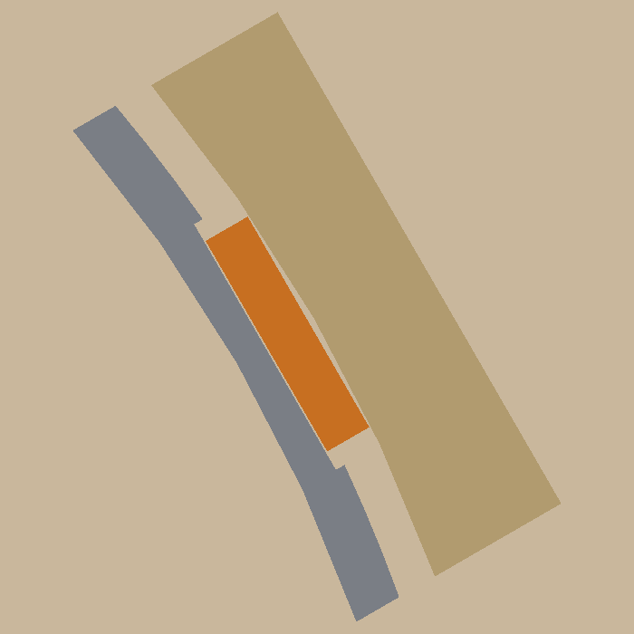

# Refill spool

 

A reusable spool for Bambu Lab 1 kg refill coils, made to use as little filament as possible: about 106 g of PLA
for both halves, against ~220 g for a solid printed spool. Spoked flanges with a thin rim and a middle ring, a Ø82 barrel with strap
tracks, and a cap that screws into the barrel top. It fits the AMS lite (Ø55 bore, 67 mm wide). A key at the barrel
half's flange pokes into the notch in the refill's cardboard core, so the coil turns with the spool. Zip ties run
down the tracks under the core and round the coil, so the coil comes off in one piece.

```bash
uv sync
uv run pytest -n 2                     # print checks, sizes, thread fit, strap paths, plates, the slicer (if installed)
uv run python -m refill_spool.build    # out/plates/refill_spool.3mf (both plates), out/step, out/render
```

Print both halves outer face down, no supports (PLA, AMS slot 3; don't dry filament on it above ~50 °C).

- **Load a refill:** slide it onto the barrel half with the core's notch over the key (any of the refill's own ties that run under the core go in the
  tracks), screw the cap on until its flange lands on the barrel top, then cut the refill's ties and pull them out
  between the spokes.
- **Take a part-used coil off:** lay the spool barrel half down and unscrew the cap first (straps on, it can't
  turn). Push a zip tie (up to ~6 × 1.2 mm) down each of the three tracks from the barrel top: the core closes
  the track over, so it comes out through the flange underneath. Close each round the coil, then lift the coil off, moving each tie round the barrel half's middle
  ring as it comes.

  

Design and decisions: [docs/specs/refill-spool.md](docs/specs/refill-spool.md). Sizes it depends on:
[docs/measurements.md](docs/measurements.md).
