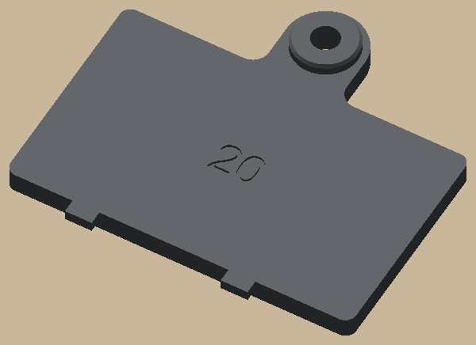
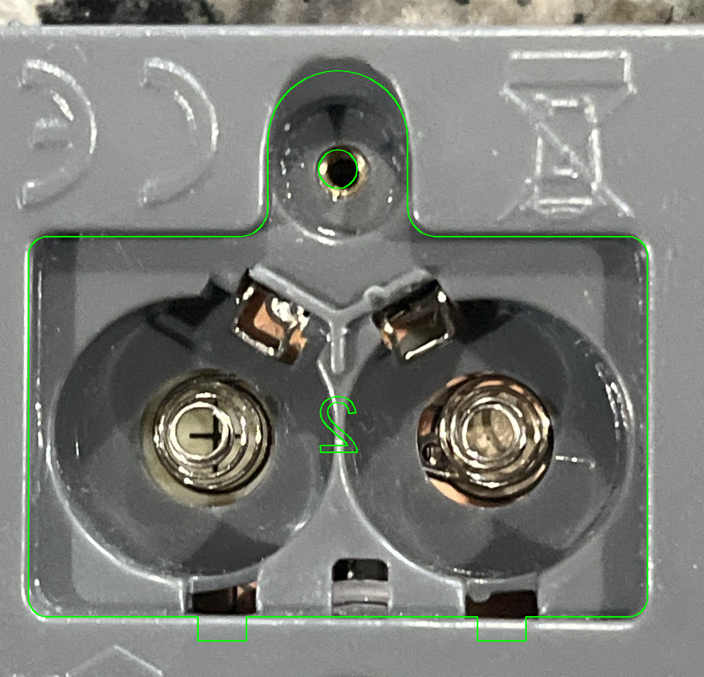

# HEXBUG remote battery cover



A replacement for the lost battery cover on a HEXBUG remote, printed in gray PETG. It fills the remote's battery
pocket (26.1 × 16.2 mm, measured off photos) less a small clearance, 1.6 mm thick, with a round-ended ear over the
screw insert and two tabs on the bottom edge that hook under the pocket's lip. The screw was lost too, so a round plug
at the tongue's end sits in the round indent over the brass insert and the snug outline holds the cover in. A hole runs through the
ear and plug over the insert.

The outline is 0.2 mm in from the pocket on every side (the second print fit) and the tongue reaches 6.4 mm past
the top edge (6.2 to 6.6 all fit the third). The plate prints three covers with screw holes 1.8, 2.0 and 2.2 mm,
engraved "18", "20", "22" on the inside face. Keep the one you like and set `hole_d` in `params.py`.


Sizes in `remote_cover/params.py`; decisions in `docs/specs/remote-cover.md`.

```bash
uv sync
uv run pytest -n 6                     # printable, sizes, the plate file, and a Bambu Studio slice (~15 s)
uv run python -m remote_cover.build    # out/plates/remote_cover.3mf (gray PETG, AMS slot 1), out/step, out/render
```

The picture in `docs/images/` is a copy of `out/render/iso.png`; refresh it after a visible change.
