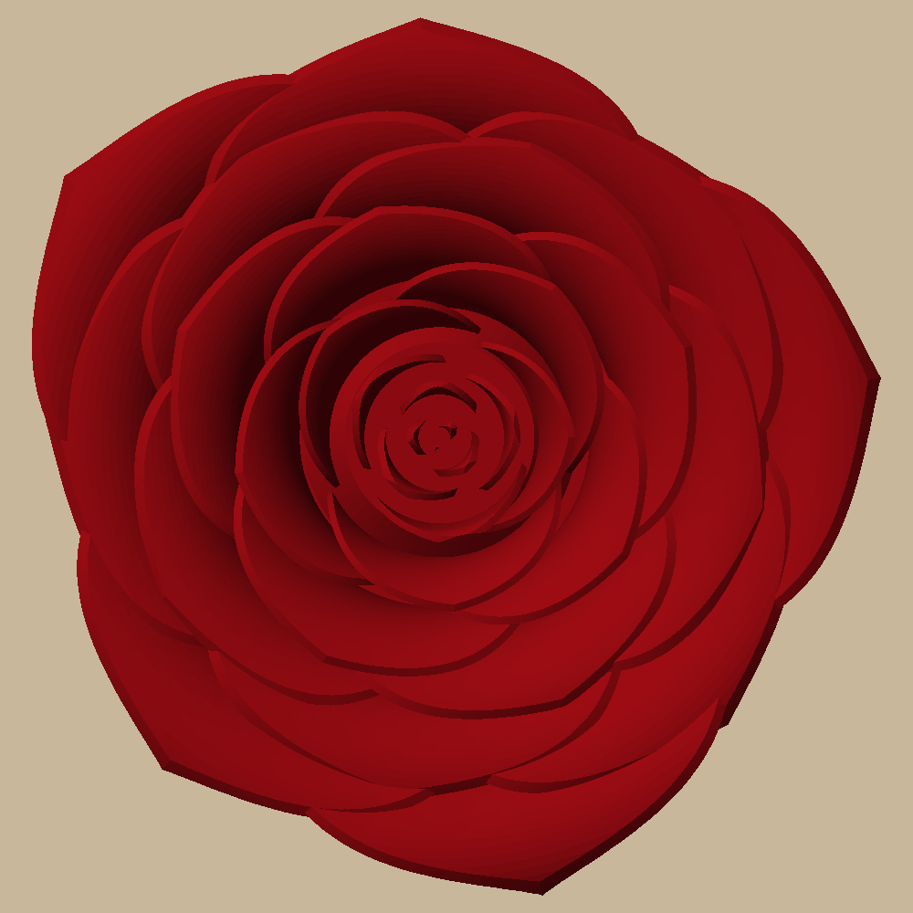
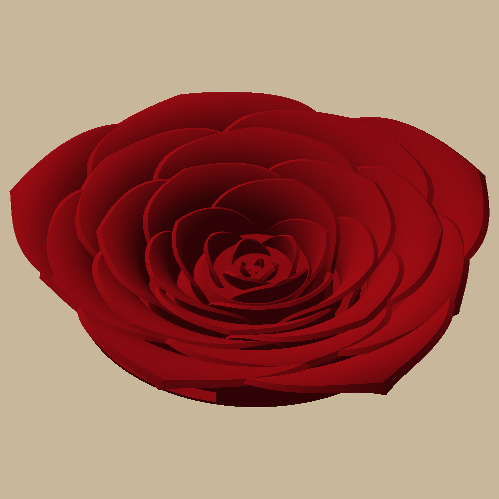
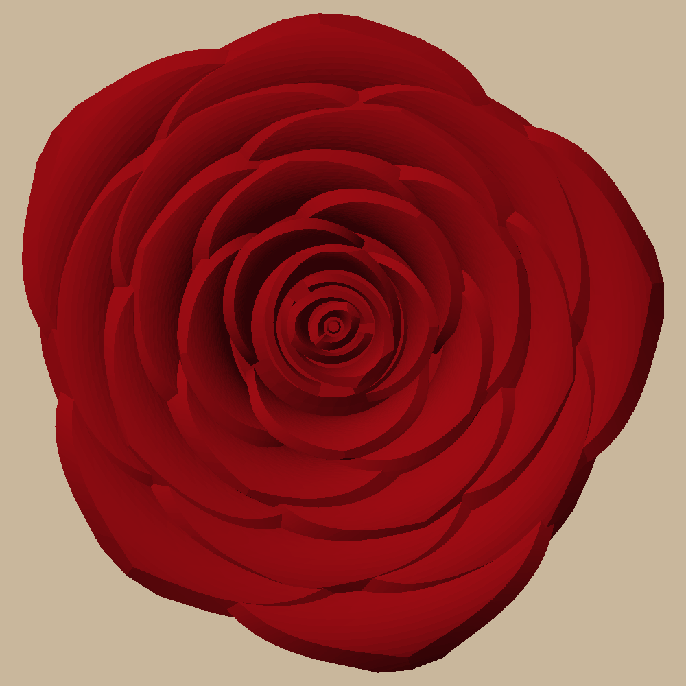
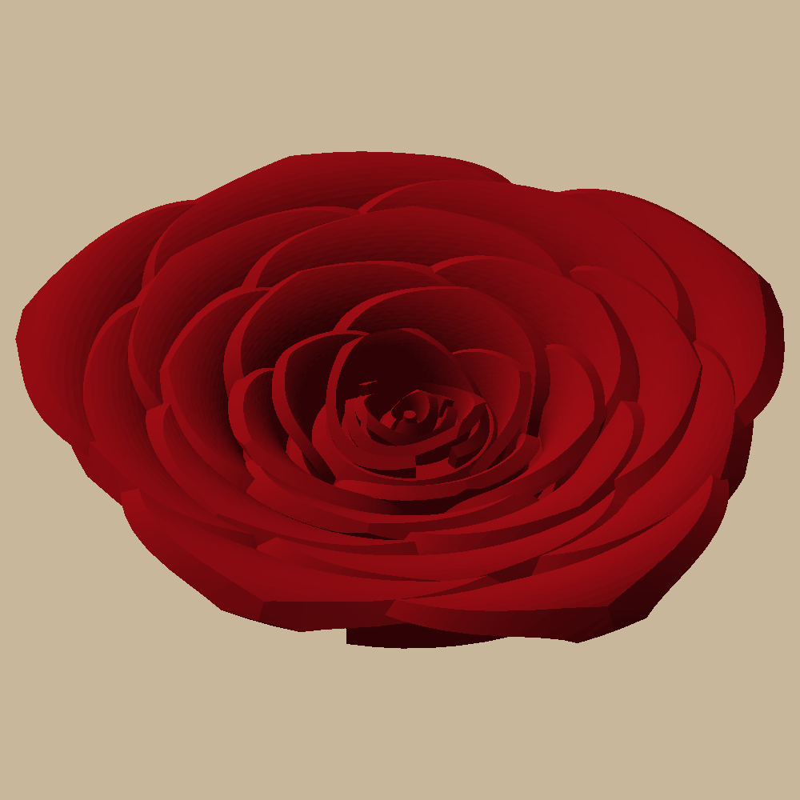

# Rose wall decor

An open rose, about 8" (203 mm) across, to hang with the sunflower (`../sunflower-wall`), or four 4" ones from one
plate. Printed in one go on a Bambu A1 + AMS lite: red PLA, flat back on the bed, no assembly.

 

24 outer petals on a golden-angle spiral rise, curve out and roll back down at their pointed tips; the centre is a
funnel of 8 small, tightly wrapped petals whose rims step down into the middle, like a real rose.

### The 4" rose

 

Half the size across, but with the same 1.6 mm petal walls, so it's no flimsier. Its centre has 4 taller petals
that lean together round a nub, so the middle looks filled in, with no floor showing. Its supports are only on
the outside: the inner petals' curls rest on hidden 45-degree fills, and only the outer five curl over the bed. It hangs on a smaller nail
(head 7 mm or less).

## Printing it

`uv run python -m rose_wall.build` writes `out/plates/rose.3mf`, a Bambu project that opens with everything set:
red PLA in AMS slot 1, PETG in slot 2. The outer petals' curl needs supports: tree supports, with PETG only where
they touch the rose (PETG doesn't stick to PLA, so they peel off clean). The centre needs none.
Sliced: 12.75 h, 303 g (285 g red, including the supports' bodies; 18 g PETG, about 74 swaps).

`out/plates/small_roses.3mf` is four 4" roses on one plate, the prime tower in the middle, the same filaments and
supports, and a support blocker over each keyhole. They share the PETG layers, so four cost the swaps of one:
9 h, 210 g (200 g red, 10.2 g PETG, about 18 swaps).

Hang it on a nail through the keyhole in the back: the nail goes where you want the rose's centre.

## Commands

```bash
uv sync
uv run pytest -n 4 -m "not slow"     # both sizes: one solid, the funnel, no supports in the centre, keyhole, plates (~12 min)
uv run pytest -n 2 -m slow           # + Bambu Studio slicing both plates with PETG-interface supports
uv run python -m rose_wall.build     # out/plates, out/rose.step, out/render
```

Design and decisions: `docs/specs/2026-10-22-rose-design.md`. The pictures in `docs/images/` are `out/render/`
copies; refresh them after a visible change.
