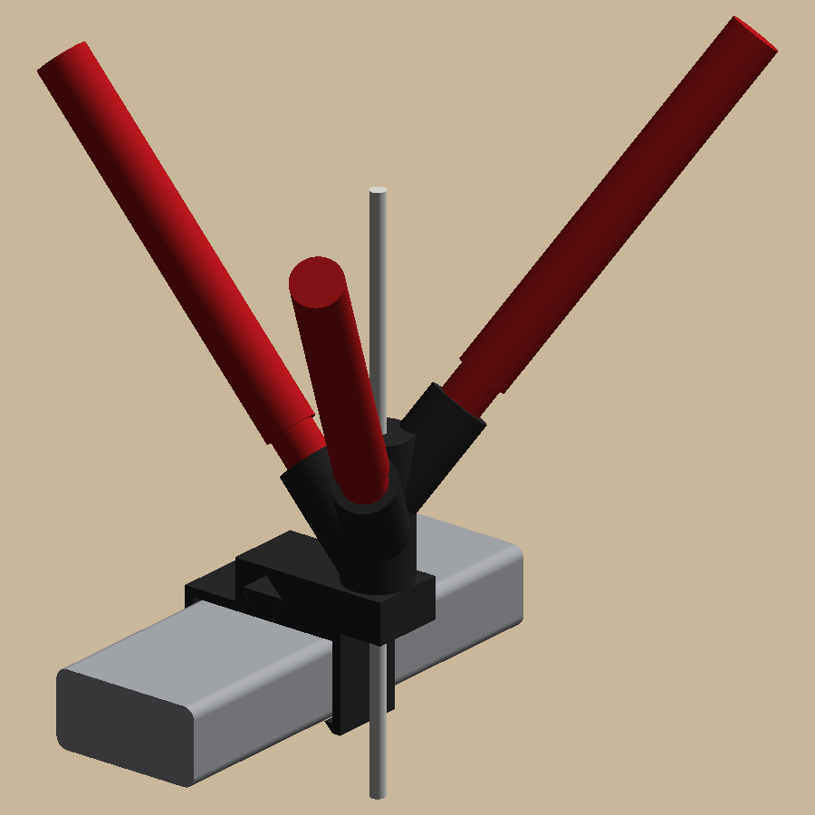
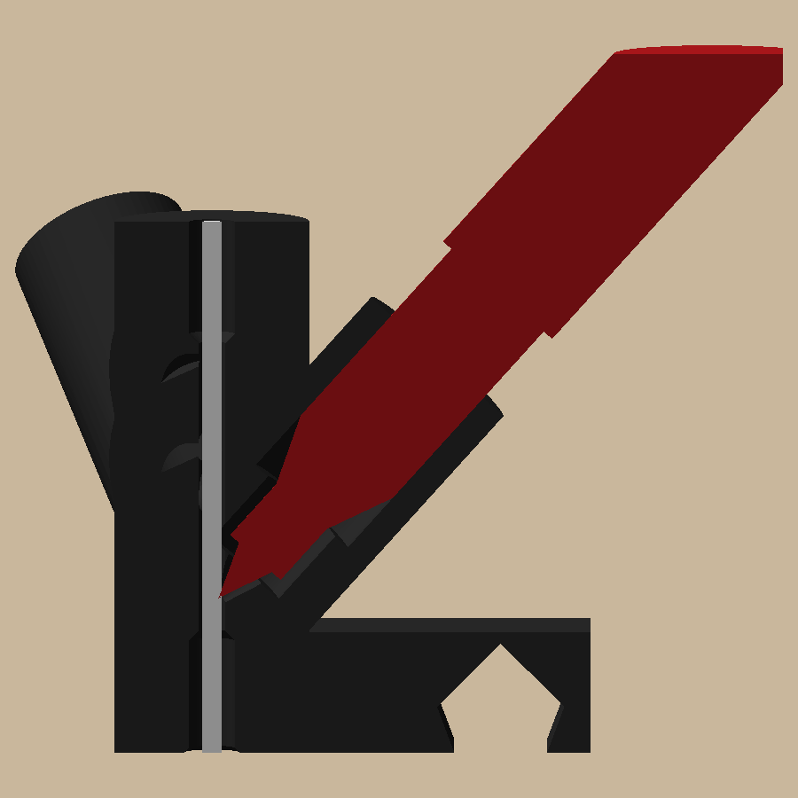
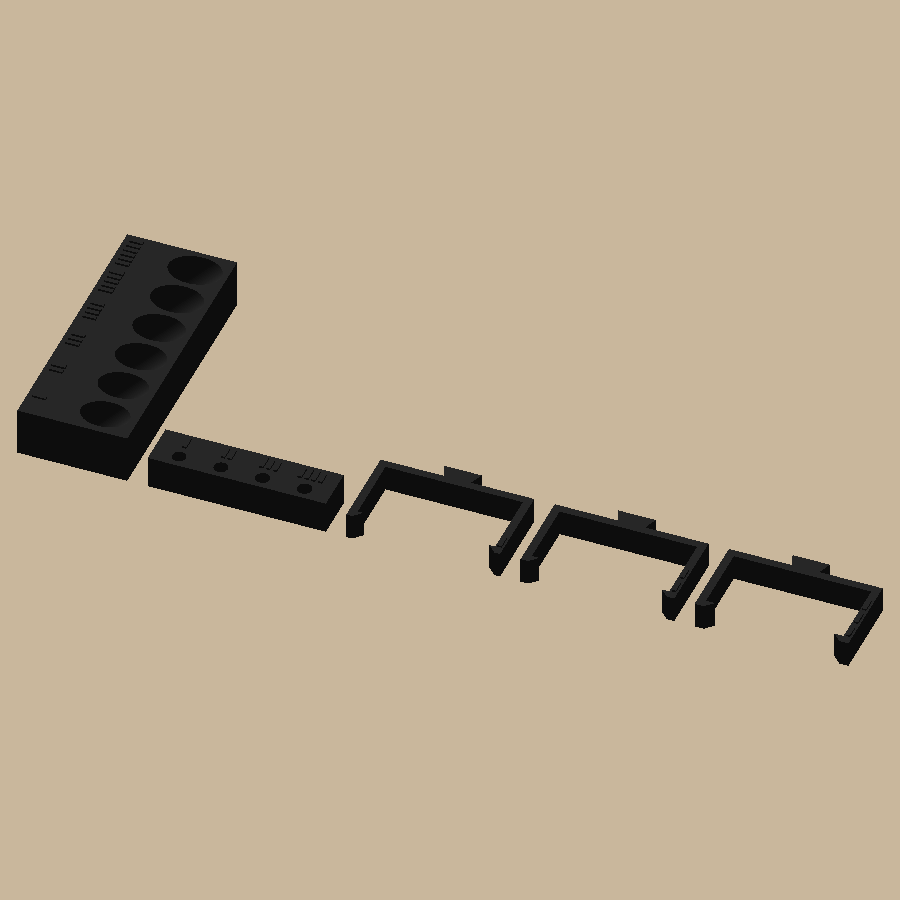

# sharpie-colorizer

 

Colors white filament with Sharpie Fine Point markers on its way to the head, so you don't have to buy a spool for
every color. It's for random prints where close enough is fine. Use one marker for a light tint, or three of the
same color for a deeper, more even one. It sits inline on the A1's external-spool guide tube:
swivel → tube → colorizer → tube → head.

It's two black parts:
- **Clip:** snaps over the 40 × 20 top frame bar beside the spool holder and slides along it.
- **Block:** slides onto the clip's dovetail rail. It holds three markers, tilted 42° with the felt pointing
  downstream. They're staggered 8 mm apart in height along a straight Ø2.4 channel, so the far wall guides a loading
  filament end past each felt.

The block can face either way on the rail. Point the outlet at the head.

## Print

1. **`fit_test_1` first** (out/plates):
   - 6 tilted marker sockets (10.6–11.6 mm)
   - 4 tube holes (4.0–4.3 mm; the chamfered bed side is the outlet's)
   - 3 clip slices (hook 1.5 / 2.0 / 2.5 mm)

   Each variant is numbered with raised bars. Put the snug ones in `sharpie_colorizer/params.py` (`marker_fit_d`,
   `tube_fit_d`, `hook`) and rebuild.

   
2. **`colorizer_1`:** the clip and the block. They print as shown, with no supports.

## Use

1. Snap the clip onto the bar and slide the block onto the rail.
2. Push the guide tube from the swivel into the top socket. Push a second tube from the bottom socket to the head.
3. Load white filament. Loading works with markers in.
4. Push each marker in until the felt touches the filament. As the felt wears, push it a little deeper. After
   about 1 mm of wear, the plastic nose gets close to the filament: time for a new marker.
5. **Before unloading, pull the markers back a few mm.** The cut end comes back up through the block toward the
   felt tips.
6. Cap the markers when you're done; they dry out in the block.

```bash
uv sync
uv run pytest -n 4 -m "not slow"     # print checks, fits, clashes, the plates (~20 s)
uv run pytest -n 4                   # plus both plates through Bambu Studio
uv run python -m sharpie_colorizer.build      # out/plates, out/step (incl. assembly.step), out/render
```

The pictures in `docs/images/` are copies of `out/render/`; refresh them after a visible change.
The design is in `docs/specs/`. The marker measurements, all by ruler, are in `docs/measurements.md`.
