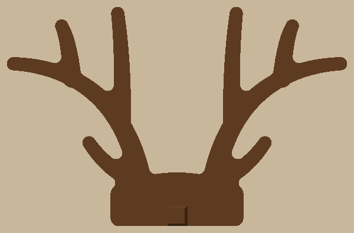

# Sheep antlers

 

Reindeer antlers for the little black sheep head: a flat 4 mm plate that sits against the back of the head, with a
5 × 4.8 mm nub, 5 mm long, that shoves into the arc-shaped slot there. The band shows 5 mm above the head like a
headband; the antlers are 82 mm tip to tip and rise 45 mm over the head. Brown PETG (AMS slot 2), one piece, lies
flat, no supports. Sizes in `sheep_antlers/params.py`; design in `docs/specs/sheep-antlers.md`.

```bash
uv sync
uv run pytest -n 6                       # printable, sizes, the nub, the plate file, a Bambu Studio slice (~15 s)
uv run python -m sheep_antlers.build     # out/plates/sheep_antlers_1.3mf (opens brown PETG), out/step, out/render
```

The pictures in `docs/images/` are copies of `out/render/`; refresh them after a visible change.
