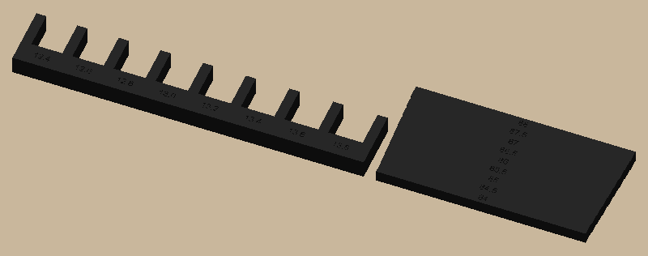

# speaker-shelf

A little black shelf that clips onto two banister rails (13 mm square tubes, 86 mm apart) and holds a vertical
speaker (base 83 × 75 mm) centered between them. No hardware: the speaker sits forward of the rail line, so its
weight cocks the clips and they pinch the rails, like a shelf bracket on a pole.



**Print the fit coupon first** (one black plate, `out/plates/fit_coupon.3mf`):

- **Rail fork:** push each slot onto a rail. Note the narrowest slot that slides on, and the one that's snug.
- **Gap gauge:** push the narrow end (84) between two rails. Note the label of the deepest step that goes in.

Those two numbers go in `docs/measurements.md` and `params.py` (`rail`, `rail_gap`), and the shelf is sized from them.

```bash
uv sync
uv run pytest -n 6                        # print checks, dimensions, the plate through Bambu Studio
uv run python -m speaker_shelf.build      # out/plates (open in Bambu Studio), out/step, out/render
```

The pictures in `docs/images/` are copies of `out/render/`; refresh them after a visible change.
