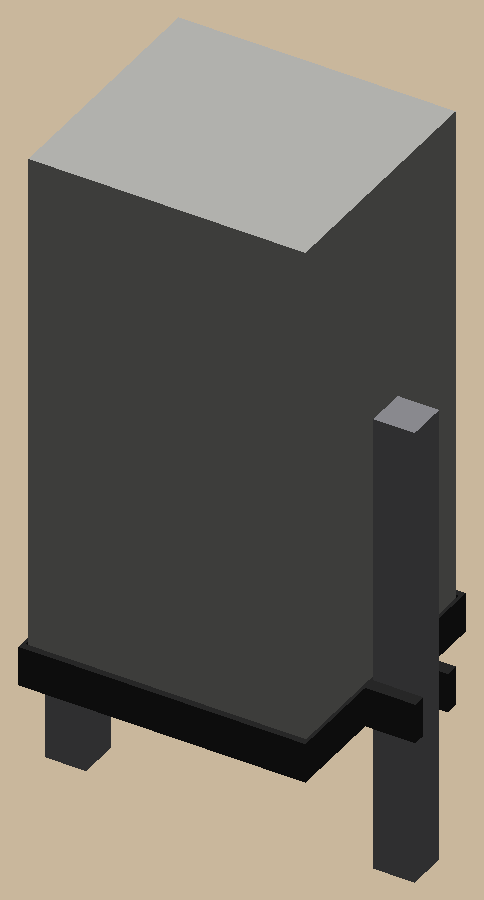
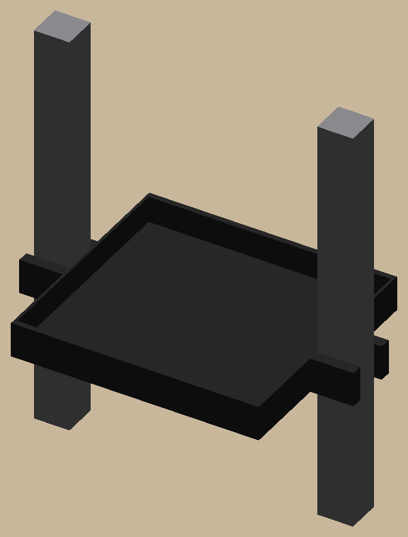

# speaker-shelf

A little black shelf for a vertical speaker (base 83 × 75 mm) between two banister rails (about 12.4 mm square, 86 mm
apart): a rectangular tray, exactly as wide as the gap, with a U on each side opening outward around a rail. The
speaker sits centered on the rails both ways.

 

Print `out/plates/speaker_shelf.3mf` (black, no supports). Hold it at an angle between the rails, twist it level so
each rail drops into its U, then set the speaker in. The rails' spring holds it; for more grip, raise `rail_gap` in
`params.py` a little (the tray gets wider and the rails pinch it).


**The fit coupon** (`out/plates/fit_coupon.3mf`) set the sizes:

- **Rail fork:** push each slot onto a rail. Note the narrowest slot that slides on, and the one that's snug.
- **Gap gauge:** push the narrow end (84) between two rails. Note the label of the deepest step that goes in.

Those two numbers are in `docs/measurements.md` and `params.py` (`rail`, `rail_gap`).

```bash
uv sync
uv run pytest -n 6                        # print checks, dimensions, the plate through Bambu Studio
uv run python -m speaker_shelf.build      # out/plates (open in Bambu Studio), out/step, out/render
```

The pictures in `docs/images/` are copies of `out/render/`; refresh them after a visible change.
