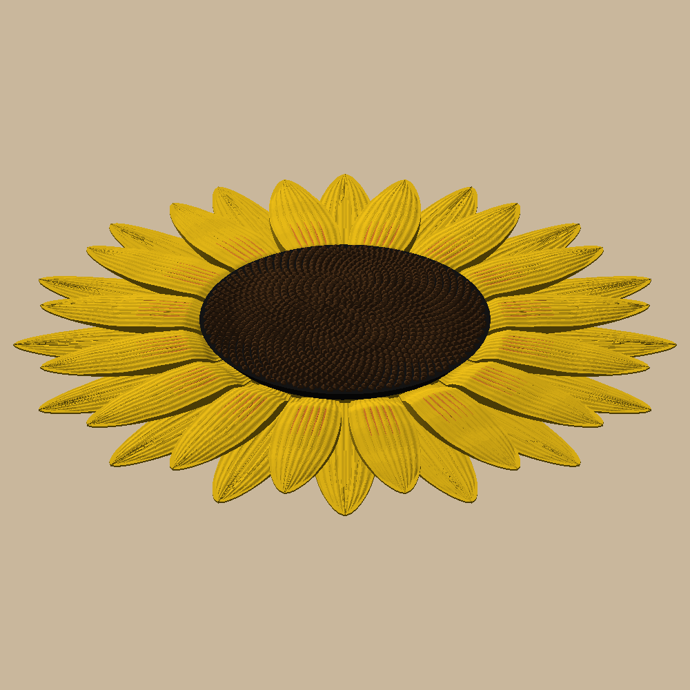
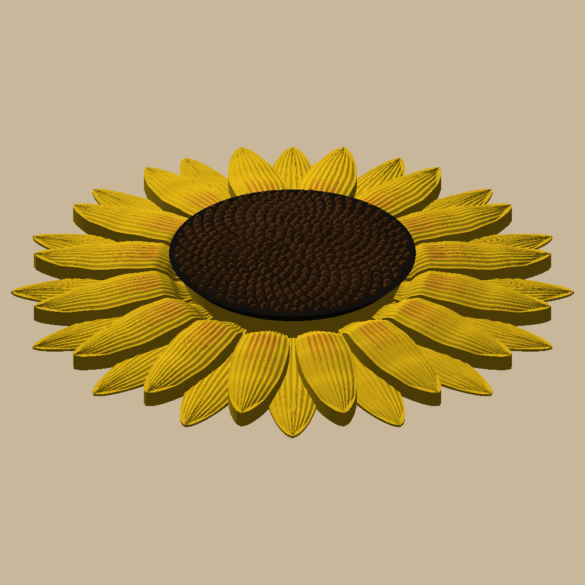

# Sunflower wall decor

A 400 mm (~16") sunflower for the wall, modeled on a real one: a big dark seed head (Fibonacci spiral) and two
rings of yellow petals that arch back. Bambu A1 + AMS lite, 0.20 mm Standard, PLA, no supports, no glue.

 

The orange streaks near the head are beads of orange down the front petals' middle valleys: from a few feet away
they read as depth, not stripes.

## What to print (`out/plates.csv`)

| Plate | Prints | Contents | Filament |
|---|---|---|---|
| `back_quarter.3mf` | 4 | back petal quarter + 3 snap pins (8 needed, 4 spare) | yellow (2) |
| `front_quarter.3mf` | 4 | front petal quarter | yellow (2) with orange (1) beads in the valleys: a swap on each of ~14 layers |
| `seed_head.3mf` | 1 | seed head | black (3), then brown (4): one color change |

AMS slots: 1 orange, 2 yellow, 3 black, 4 brown (`filaments` and `slot_*` in `sunflower/params.py`). The plates
open already colored: File → Open Project.

## The 10" one-piece print

 

`uv run python -m sunflower.build small` writes `out/small/`: one plate, `plates/sunflower_10in.3mf`, with the
whole flower (250 mm) stacked in place. It prints yellow with the orange beads, then black, then brown, with the
prime tower in the bed's front-left corner: 9.2 h, 203 g. No assembly: hang it by the keyhole behind the first
front petal, on a nail 2 3/16" above where the flower's center should be (`docs/measurements.md`).

## Assembly

1. Lay the seed head face down on a towel.
2. Set the 4 front quarters (no keyhole) on it, flat side up, hub to hub; their pin slots line up with the sockets.
3. Set the 4 back quarters on top, turned so their slots line up too (the seams land between petals).
4. Push a pin through each of the 8 slots, barbs first, until it clicks and its head sits flush.
5. Hang it on a pan-head screw (#8 / M4, head ≤ 8.5 mm × 3 mm) through the keyhole of whichever back quarter is
   at the top: head in the round hole, then let it drop. Leave the underside of the screw head 1.6–3 mm off the
   wall so the flower sits flat against it.

The petal tops arch, so 0.2 mm layers show as faint contour lines; the petal plates also slice fine at 0.12 mm
for smoother tops (the 1.6 mm pin-head recess isn't a 0.12 multiple, so the heads may sit ~0.1 mm proud: harmless).

## Commands

```bash
uv sync
uv run pytest -n 6 -m "not slow"          # ~2 min: printable, watertight, layers, fits, nothing overlaps
uv run pytest -n 5                        # + the plate files and Bambu Studio slicing each plate (~10 min)
uv run python -m sunflower.build          # out/plates, out/step, out/render
uv run python -m sunflower.build small    # out/small: the 10" one-piece print
```

Design and decisions: `docs/specs/2026-10-15-sunflower-design.md`. The pictures in `docs/images/` are
`build render` / `build small` output; refresh them after a visible change.
Before the first print, check `fit` (slot clearance) with `../fit-coupon`.
