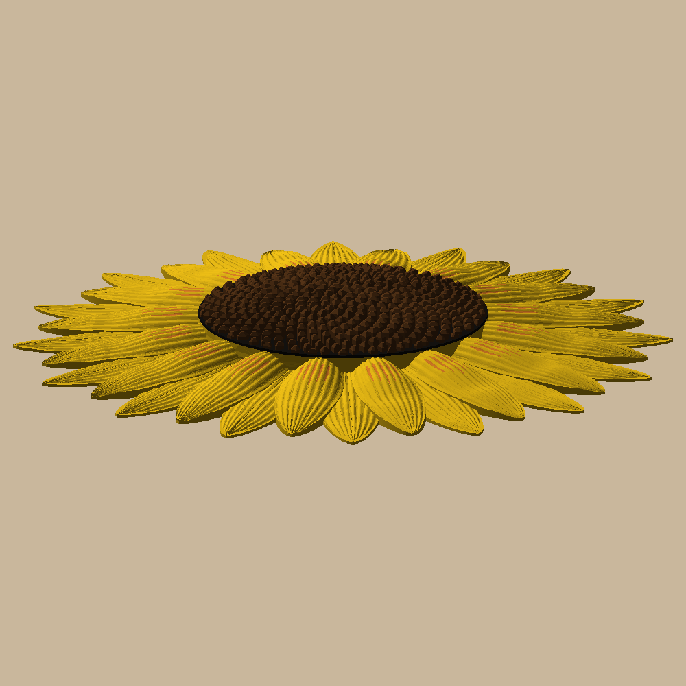

# Sunflower wall decor

A 250 mm (~10") sunflower for the wall, printed in one go on a Bambu A1 + AMS lite: a domed seed head (Fibonacci
spiral of diamond seeds) and two rings of yellow petals, the front ones rising to the head and sweeping back down
to the plate. 0.20 mm Standard, PLA, no supports, no glue, no assembly.

 

The orange streaks near the head are beads of orange down the front petals' middle valleys: from a few feet away
they read as depth, not stripes.

## Printing it

`uv run python -m sunflower.build` writes `out/plates/sunflower_10in.3mf`: one plate with the whole flower
stacked in place, a Bambu project that opens already colored (File → Open Project). It prints yellow (the orange
beads share some of those layers: a swap on each), then black, then brown, with the prime tower in the bed's
front-left corner: 9.3 h, 176 g (123 g yellow, 2 g orange, 14 g black, 37 g brown), 18 color swaps.

AMS slots: 1 orange, 2 yellow, 3 black, 4 brown (`filaments` and `slot_*` in `sunflower/params.py`).

Hang it by the keyhole behind the first front petal, on a nail 2 3/16" above where the flower's center should be
(`docs/measurements.md`).

The petal tops arch, so 0.2 mm layers show as faint contour lines.

## Commands

```bash
uv sync
uv run pytest -n 3 --dist loadfile -m "not slow"   # printable, watertight, layers, colors by height, the keyhole
uv run pytest -n 3 --dist loadfile                 # + the build and Bambu Studio slicing the plate
uv run python -m sunflower.build                   # out/plates, out/sunflower_10in.step, out/render
uv run python -m sunflower.build makerworld        # out/makerworld: the sliced project, to upload
```

Design and decisions: `docs/specs/2026-10-15-sunflower-design.md`. The pictures in `docs/images/` are
`build render` output; refresh them after a visible change.
